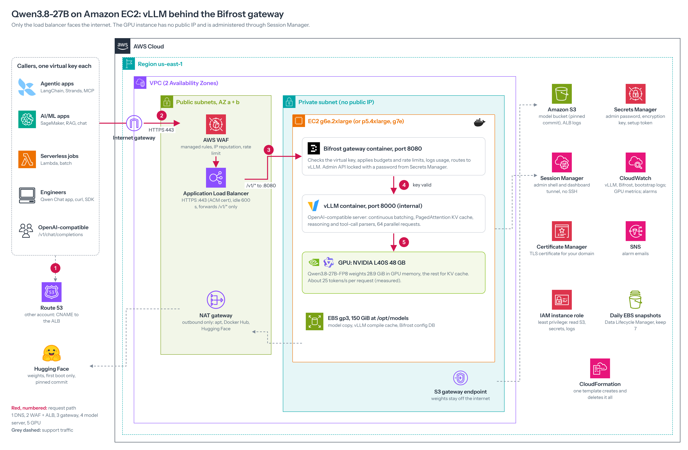

# Qwen3.8-27B on Amazon EC2 with vLLM and Bifrost

One CloudFormation template that builds a private, OpenAI-compatible Qwen3.8-27B endpoint on one GPU instance in
us-east-1:

- **vLLM** serves the model.
- **Bifrost** is the gateway in front: one virtual key per caller.
- **WAF and an internet-facing ALB** are the only things that face the internet.
- **The GPU instance** sits in a private subnet with no public IP.

Every step was run and verified on a real g6e.2xlarge in October 2026.

**Full solution guide** (concepts, sizing, step-by-step, troubleshooting, evidence):
[Self-Hosting Qwen3.8-27B on Amazon EC2 with vLLM and Bifrost: Solution Guide](https://claude.ai/code/artifact/66b87154-1232-436c-be18-9e0c9305d0f7)
(a Claude Doc, shared separately). This README is the quick start.



## Repository layout

| Path | Runs in | Purpose |
|---|---|---|
| `cloudformation/llm-qwen-gpu-bifrost.yaml` | CloudFormation | **Current template.** VPC, NAT, S3, Secrets Manager, IAM, GPU instance, ALB, WAF, alarms, snapshots, clean-delete helper. g6e, g7e or p5.4xlarge |
| `cloudformation/params/params-g6e.json` | CloudFormation | g6e.2xlarge, 1x L40S 48 GB, 64K context, 64 parallel requests |
| `cloudformation/params/params-g7e.json` | CloudFormation | g7e.2xlarge, 1x RTX PRO 6000 96 GB, 128K context, 128 parallel requests |
| `cloudformation/params/params-p5.json` | CloudFormation | p5.4xlarge, 1x H100 80 GB, 128K context, 128 parallel requests |
| `cloudformation/previous/` | Reference only | First template (v1, g7e-only) and its parameters. Superseded; kept for history (see CHANGELOG) |
| `scripts/reserve-gpu.sh` | CloudShell | Retries an On-Demand Capacity Reservation until one is **active** |
| `scripts/verify-llm-host.sh` | Instance (SSM) | Read-only health check of every layer |
| `scripts/llm-admin.py` | Instance (SSM) | Create, list, revoke and test Bifrost virtual keys; status summary |
| `apps/qwen-chat/` | Laptop | Local chat UI: streaming, thinking panel, files, timing summary. `npm start` |
| `docs/architecture.png` | | Architecture diagram |

## Quick start

1. **Capacity.**
   - g6e or g7e: `TYPE=g6e.2xlarge bash scripts/reserve-gpu.sh`. It prints the zone to use.
   - p5.4xlarge: buy an EC2 Capacity Block for ML instead.
2. **Parameters.** In `cloudformation/params/params-<type>.json`, set:
   - `CertificateArn` (an Issued ACM certificate in the same account, us-east-1);
   - `DomainName`;
   - `GpuAvailabilityZone` (from step 1), with `GpuHostPlacement=private-a`;
   - `AlarmEmail`, to get alarm emails (confirm the SNS subscription email);
   - `ProjectName`, unique per stack.
3. **Create the stack (CloudShell).** The template is about 62 KB, over the 51,200-byte inline limit, so stage it in S3:
   ```bash
   STACK=freyr-llm-qwen-stack          # one name per stack, e.g. freyr-llm-qwen-p5
   BUCKET=cfn-templates-$(aws sts get-caller-identity --query Account --output text)-us-east-1
   aws s3api head-bucket --bucket $BUCKET 2>/dev/null || aws s3 mb s3://$BUCKET --region us-east-1
   aws s3 cp cloudformation/llm-qwen-gpu-bifrost.yaml s3://$BUCKET/llm-qwen-gpu-bifrost.yaml
   aws cloudformation create-stack --region us-east-1 --stack-name $STACK \
     --template-url https://$BUCKET.s3.us-east-1.amazonaws.com/llm-qwen-gpu-bifrost.yaml \
     --parameters file://cloudformation/params/params-g6e.json --capabilities CAPABILITY_IAM
   aws cloudformation wait stack-create-complete --region us-east-1 --stack-name $STACK && echo DONE
   ```
   The console's *Upload a template file* works too. Expect 25 to 45 minutes on a first launch.
4. **DNS.** Create a CNAME from your domain to the `LoadBalancerDnsName` output, in the Route 53 account.
5. **On the instance (Session Manager).** Run `sudo -i` and `cd /root` first, so you have a writable folder and bash. Copy the two scripts there (for example `nano verify-llm-host.sh`, paste, save), then run:
   ```bash
   sudo bash verify-llm-host.sh                 # all PASS
   sudo python3 llm-admin.py status             # gateway, admin lock, private network
   sudo python3 llm-admin.py create my-laptop   # prints an sk-bf-... key once
   ```
6. **Call it.**
   ```bash
   curl -s https://<your-domain>/v1/chat/completions -H 'Content-Type: application/json' -H "x-bf-vk: <key>" \
     -d '{"model":"vllm/qwen3.8-27b","messages":[{"role":"user","content":"Hello"}],"max_tokens":2048,"reasoning_effort":"low"}'
   ```

## Rules for callers

- **Model name:** `vllm/qwen3.8-27b`. The key goes in `x-bf-vk`, or as the OpenAI SDK `api_key`.
- **`reasoning_effort`:**
  - `low` or `medium` work.
  - `high` returns HTTP 500 (Qwen3.8 chat template).
  - `xhigh` may be rewritten to `high` by Bifrost (maximhq/bifrost#6193), so test it before relying on it.
- **`max_tokens`:** it covers thinking plus the answer. 16384 is a good default.

## Before any stack update

- **Pin the AMI:** set `AmiIdOverride` to the `AmiInUse` output. Otherwise a newer Deep Learning AMI replaces the instance.
- **Know what forces a replacement:** any change to image tags, `MaxModelLen`, `MaxNumSeqs`, `MtpSpeculativeTokens` or the model changes the user data, which replaces the instance (new disk, empty Bifrost). Use a change set and check that `GpuHost` shows no replacement.
- **Remove write access to the model bucket:** set `AllowModelStagingWrite=false` after the first launch.

## Tear down

```bash
aws ec2 cancel-capacity-reservation --region us-east-1 --capacity-reservation-id <cr-...>
aws cloudformation delete-stack --region us-east-1 --stack-name $STACK
```

A clean-up function empties the buckets and deletes the stack's snapshots, so the delete never blocks. Remove the
CNAME yourself.

## Validation done on this repo

- **Template:** `cfn-lint` 1.57 reports 0 findings, including informational ones.
- **Startup script:** rendered and passes ShellCheck.
- **Config files written by the startup script:** valid JSON and YAML.
- **Parameter files:** all three pass every template constraint.
- **`reserve-gpu.sh`:** tested against a fake AWS CLI, 7 cases.
- **`llm-admin.py`:** tested against a mock Bifrost.
- **Clean-up Lambda:** tested with moto.
- **Live on g6e.2xlarge (us-east-1):**
  - stack CREATE_COMPLETE;
  - all `verify-llm-host.sh` checks PASS;
  - admin lock from `config.json` confirmed;
  - end-to-end request through WAF, ALB, Bifrost and vLLM at about 25 tokens/s.
- **Not yet run on real hardware:** g7e and p5.4xlarge launches, and `MtpSpeculativeTokens` > 0.
