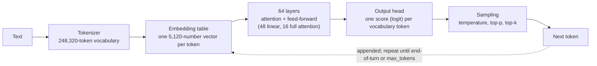
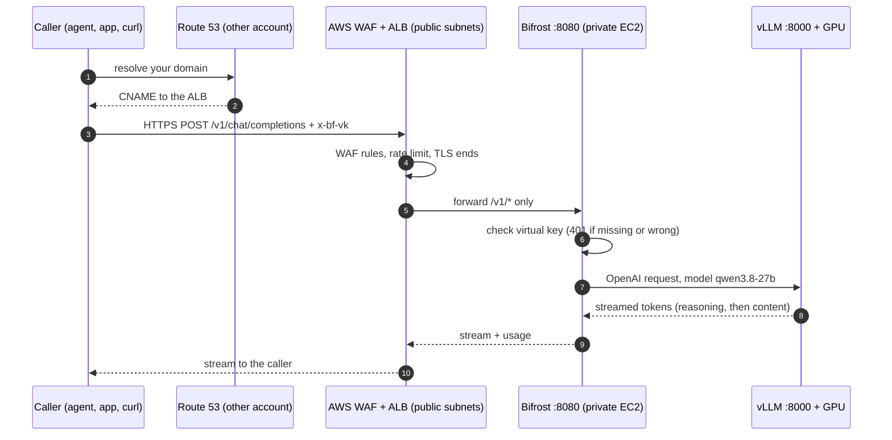
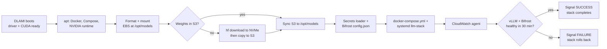

# Self-Hosting Qwen3.8-27B on Amazon EC2 with vLLM and Bifrost: Solution Guide

Last updated 19 October 2026 · Version 4 · Author: Ram (Freyr) · **[Interactive version](https://claude.ai/artifact/JmfPaYGYuj8Hgm8hBrgcfA)** (or open [`docs/site/index.html`](site/index.html) from a clone) · **[Word version](Solution-Guide.docx)**

**Contents**

- [1. How to use this guide](#1-how-to-use-this-guide)
- [2. LLM fundamentals every AI infrastructure engineer needs](#2-llm-fundamentals-every-ai-infrastructure-engineer-needs)
- [3. Why self-host an open-weight model](#3-why-self-host-an-open-weight-model)
- [4. Qwen3.8-27B: the facts this build relies on](#4-qwen38-27b-the-facts-this-build-relies-on)
- [5. vLLM: the model server](#5-vllm-the-model-server)
- [6. The LLM gateway: why Bifrost sits in front of vLLM](#6-the-llm-gateway-why-bifrost-sits-in-front-of-vllm)
- [7. Architecture](#7-architecture)
- [8. Choosing the GPU](#8-choosing-the-gpu)
- [9. Repository and files](#9-repository-and-files)
- [10. Prerequisites](#10-prerequisites)
- [11. Step-by-step deployment](#11-step-by-step-deployment)
- [12. Inside the EC2 instance: what the bootstrap installs and why](#12-inside-the-ec2-instance-what-the-bootstrap-installs-and-why)
- [13. After deployment: verify, create keys, make the first call](#13-after-deployment-verify-create-keys-make-the-first-call)
- [14. Operations](#14-operations)
- [15. Security model](#15-security-model)
- [16. Troubleshooting and lessons learned](#16-troubleshooting-and-lessons-learned)
- [17. Teardown](#17-teardown)
- [18. GPU and instance primer](#18-gpu-and-instance-primer)
- [19. Observability and benchmarking](#19-observability-and-benchmarking)
- [20. Scaling, high availability and recovery](#20-scaling-high-availability-and-recovery)
- [21. Cost engineering](#21-cost-engineering)
- [22. Model lifecycle: evaluate, upgrade, customise](#22-model-lifecycle-evaluate-upgrade-customise)
- [23. Security for LLM applications](#23-security-for-llm-applications)
- [24. API request reference](#24-api-request-reference)
- [25. Template reference](#25-template-reference)
- [26. Glossary](#26-glossary)
- [27. References](#27-references)

## 1. How to use this guide

This guide takes you from an empty AWS account to a private, OpenAI-compatible Qwen3.8-27B endpoint that agents and applications call over HTTPS. One CloudFormation template builds everything, and every step was run and verified on a real instance in us-east-1 in October 2026.

**Other formats.** The same guide is in the repository as an [interactive page](https://claude.ai/artifact/JmfPaYGYuj8Hgm8hBrgcfA) with search, reading paths, a clickable architecture and GPU planners ([docs/site/index.html](https://github.com/itscloudram/llm/blob/main/docs/site/index.html)), as [Markdown](https://github.com/itscloudram/llm/blob/main/docs/GUIDE.md) and as a [Word file](https://github.com/itscloudram/llm/blob/main/docs/Solution-Guide.docx).

**What you end up with**

- `https://<your-domain>/v1/chat/completions`: an OpenAI-compatible API in front of a model you host yourself.
- Every caller needs its own **virtual key**, so you can see, limit or revoke each application separately.
- The GPU instance has no public IP. Only a load balancer with a web firewall (WAF) faces the internet.
- Streaming answers, visible reasoning, tool calling and image input, served by vLLM on one NVIDIA GPU.

**Pick your path**

| You are | Read in this order | Time to a working endpoint |
| --- | --- | --- |
| New to AI infrastructure | Sections 2 to 7 (concepts), then 10 to 13 (build), then 16 (problems seen), then 18 to 24 (running it well) | A day, including reading |
| Comfortable with AWS, new to LLM serving | Sections 2, 5, 6 and 8, then 10 to 13, then 19 to 21 | Half a day |
| Experienced, need to deploy | Sections 9 to 13, keep 16 and 25 open | About an hour, mostly waiting for the model to download and load |

**Conventions**

- `Monospace` is something you type or a value you will see. Commands run in **CloudShell** (AWS console, top bar) unless marked **SSM**, which means a Session Manager shell on the GPU instance.
- Every fact comes with its source: a link to official documentation, or **Measured** when it was observed on our own instance.
- Prices are On-Demand, us-east-1, Linux, as checked in October 2026. Check them again before you budget.
- Region is us-east-1 throughout. The template enforces it, and section 8 explains how to change it.

## 2. LLM fundamentals every AI infrastructure engineer needs

An LLM server spends its time in two very different phases. Reading the prompt (**prefill**) is limited by GPU compute. Writing the answer one token at a time (**decode**) is limited by how fast the GPU can read its own memory. Almost every sizing decision in this guide follows from that split.

### Parameters: what "27B" means

A model's **parameters** (also called **weights**) are the numbers it learned during training. Qwen3.8-27B has about 27 billion of them. They are stored in the checkpoint files, loaded into GPU memory once at start-up, and never change while the model serves requests. Every token the model writes is computed from the prompt and these numbers.

Three different things are called "parameters", and it helps to keep them apart:

| Name | What it is | Who sets it | Example in this build |
| --- | --- | --- | --- |
| **Model parameters (weights)** | The learned numbers inside the network | Training, by Qwen | 27 billion, in `Qwen/Qwen3.8-27B-FP8` |
| **Architecture hyperparameters** | The shape of the network: layers, widths, heads, vocabulary | The model designers, fixed in `config.json` | 64 layers, hidden size 5,120 |
| **Request (sampling) parameters** | Settings sent with each request that control how the next token is picked | You, per request | `temperature`, `top_p`, `max_tokens` |

More parameters generally means more knowledge and better reasoning, but also more GPU memory and slower decoding, because every parameter is read from memory for every generated token (see the 25 tokens/s calculation below).

### How a transformer turns tokens into the next token

Qwen3.8 is a **transformer**, the architecture behind almost every current LLM. One step of generation works like this:

1. **Tokenize.** The text becomes token IDs from a fixed vocabulary of 248,320 entries.
2. **Embed.** Each token ID selects a row of the **embedding table**: a vector of 5,120 numbers that represents that token. This vector is the token's **embedding**.
3. **Run the layers.** The vectors pass through 64 layers in turn. Each layer has two parts:
   - an **attention** block (full attention or linear attention), where each token looks at the tokens before it and mixes in what is relevant;
   - a **feed-forward (MLP)** block, which transforms each token's vector on its own.
4. **Score the vocabulary.** The last vector is multiplied by the **output head** to give one score (a **logit**) for each of the 248,320 possible next tokens.
5. **Sample.** The request parameters (`temperature`, `top_p`, `top_k`) turn those scores into probabilities and pick one token.
6. **Repeat.** The new token is appended, and the loop runs again until the model writes an end-of-turn token or reaches `max_tokens`.



Step 3 is where the KV cache comes in. The attention blocks need the keys and values of every earlier token, so vLLM keeps them in GPU memory instead of recomputing them.

### Inside Qwen3.8-27B: the architecture in numbers

All values come from the pinned [`config.json`](https://huggingface.co/Qwen/Qwen3.8-27B-FP8/blob/017b9c7af6b5689d5dd426a76e0bc077eb5ca20a/config.json).

| Setting | Value | What it means |
| --- | --- | --- |
| `num_hidden_layers` | 64 | Transformer layers, stacked |
| `layer_types` | 48 `linear_attention`, 16 `full_attention` | Every fourth layer is full attention; the other three use Gated DeltaNet |
| `hidden_size` | 5,120 | Length of each token's vector inside the model |
| `intermediate_size` | 17,408 | Width of the feed-forward block in each layer |
| `num_attention_heads` / `num_key_value_heads` | 24 / 4 | Query heads and shared key/value heads in the full-attention layers (grouped-query attention); fewer KV heads means a smaller KV cache |
| `head_dim` | 256 | Size of each attention head |
| `linear_num_key_heads` / `linear_num_value_heads` | 16 / 48 | Heads in the linear-attention layers, each of dimension 128 |
| `vocab_size` | 248,320 | Number of distinct tokens |
| `max_position_embeddings` | 262,144 | Native context length |
| `rope_theta` | 10,000,000 | Base of the rotary position encoding; a large value supports long context |
| `tie_word_embeddings` | false | The input embedding table and the output head are separate matrices |
| `mtp_num_hidden_layers` | 1 | One extra layer for multi-token prediction |
| `vision_config` | 27 layers, hidden size 1,152 | The image encoder |
| `quantization_config` | FP8 `e4m3`, blocks of 128 × 128, dynamic activations | How the FP8 checkpoint was made |

**Where the 27 billion parameters are.** This is an approximate count from the values above (our arithmetic, rounded):

| Part | Calculation | Parameters |
| --- | --- | --- |
| Feed-forward blocks | 3 matrices × 5,120 × 17,408 × 64 layers | about 17.1 billion |
| Linear-attention blocks | 48 layers × about 115 million | about 5.5 billion |
| Full-attention blocks | 16 layers × about 75 to 105 million | about 1.2 to 1.7 billion |
| Embedding table and output head | 2 × 248,320 × 5,120 | about 2.5 billion |
| Vision encoder | 27 layers × about 16 million | about 0.4 billion |
| **Total** |  | **about 27 billion** |

So nearly two thirds of the model is the feed-forward blocks, which is typical of transformers.

### From parameters to gigabytes

GPU memory for the weights is roughly **parameters × bytes per parameter**:

| Format | Bytes per parameter | Qwen3.8-27B weights |
| --- | --- | --- |
| FP32 (training) | 4 | about 108 GB |
| BF16 (original checkpoint) | 2 | about 54 GB |
| FP8 (this build) | 1 | about 27 GB, plus the parts kept in BF16 |
| INT4 / FP4 | 0.5 | about 14 GB, not used here |

The FP8 checkpoint keeps some parts in BF16 (`modules_to_not_convert`): the embedding table, the output head, the norms and the vision encoder. Those are about 2.9 billion parameters at 2 bytes, roughly 6 GB. That brings the total to roughly 30 GB, which matches the **measured** 28.9 GiB (31 GB) that vLLM reported loading.

**Rule of thumb:** a dense model needs about 1 GB of GPU memory per billion parameters in FP8, or 2 GB in BF16, for the weights alone. Then add the KV cache and about 10% headroom.

### How an LLM is made

You don't train anything in this build, but knowing the stages explains the model's behaviour:

1. **Pre-training.** The model learns to predict the next token over trillions of tokens of text and code. This is where its knowledge and language ability come from, and almost all of the training compute.
2. **Long-context and mid-training.** Further training on long documents and selected data, which is how the context window reaches 262,144 tokens.
3. **Supervised fine-tuning (SFT).** Training on example conversations, so it follows instructions and uses the chat template.
4. **Preference alignment.** Methods such as RLHF (reinforcement learning from human feedback) and DPO (direct preference optimisation) teach it which of two answers people prefer: more helpful, safer, better formatted.
5. **Reinforcement learning for reasoning.** Rewarding correct final answers on checkable tasks (maths, code) is what produces the long "thinking" behaviour.

**Open-weight is not the same as open-source.** Qwen releases the weights under Apache 2.0, so you may run, modify and sell products built on them. The training data and the full training code are not published. For self-hosting, the weights and licence are what matter.

**Knowledge has a cut-off.** The model knows nothing after its training data ends, and nothing about your company. Retrieval (RAG) and tools add that knowledge at request time; see "Prompting, RAG, fine-tuning and agents" below.

### Dense and mixture-of-experts models

Qwen3.8-27B is **dense**: every parameter takes part in every token. Many large models are **mixture-of-experts (MoE)** instead. Each layer holds many "expert" feed-forward blocks, and a router sends each token to only a few of them. Qwen3-235B-A22B, for example, has 235 billion parameters in total, of which 22 billion are active per token.

|  | Dense (this model) | Mixture-of-experts |
| --- | --- | --- |
| GPU memory | All parameters | All parameters (every expert must be loaded) |
| Bytes read per token | All parameters | Only the active parameters |
| Decode speed on the same GPU | Set by total size | Faster than a dense model of the same total size |
| Fits one 48 GB GPU | Yes, at 27B in FP8 | Usually not; large MoE models need several GPUs |

MoE trades memory for speed. For one GPU, a dense model of this size is the practical choice.

### Tokens and the chat template

Models read and write **tokens**, pieces of words, not characters. Your message is wrapped in a **chat template** (role markers, the start of the assistant's turn, the thinking tag) before the model sees it. **Measured:** the one-word message `Hi` cost 41 input tokens, because the template adds about 40 fixed tokens to every request.

### Context window

The context window is the most tokens one request can hold: prompt, chat history, attached files, thinking and answer combined. Qwen3.8-27B supports 262,144 tokens natively ([config](https://huggingface.co/Qwen/Qwen3.8-27B-FP8/raw/017b9c7af6b5689d5dd426a76e0bc077eb5ca20a/config.json): `max_position_embeddings: 262144`). On the 48 GB g6e this guide caps it at 65,536 (`MaxModelLen`) to leave GPU memory for the cache described next. A request over the cap is rejected with HTTP 400, not silently trimmed.

### Prefill, decode and why one request runs at about 25 tokens/s

To write each new token, the GPU reads every model weight from its memory once. So the most tokens per second one request can get is roughly memory bandwidth divided by model size:

```math
\text{tokens/s}_{\max} \approx \frac{\text{GPU memory bandwidth}}{\text{bytes of weights}} = \frac{864\ \text{GB/s (L40S)}}{31\ \text{GB}\ (28.9\ \text{GiB})} \approx 28
```

**Measured** on g6e.2xlarge: 25.0 tokens/s, about 90% of that ceiling. Running more requests at once raises total throughput, because each memory read serves every request in the batch, but each user still sees about 25 tokens/s. Faster memory is the only hardware fix; section 8 compares the options.

Prefill is different: the whole prompt is processed in parallel, so it is limited by compute and shows up as **time to first token**. **Measured:** 401 ms for a short prompt, including the round trip from Bangalore to us-east-1.

**Evidence.** NVIDIA: *"Model execution is frequently memory-bandwidth bound—in particular, bandwidth-bound in the weights"* ([NVIDIA technical blog](https://developer.nvidia.com/blog/mastering-llm-techniques-inference-optimization/)). Databricks: *"Generating the first token is typically compute-bound, while subsequent decoding is memory-bound"* ([Databricks engineering blog](https://www.databricks.com/blog/llm-inference-performance-engineering-best-practices)). The L40S's 864 GB/s comes from [NVIDIA's L40S page](https://www.nvidia.com/en-us/data-center/l40s/).

### KV cache: the memory that limits context and concurrency

While generating, the model keeps a key and a value vector for every past token in every attention layer: the **KV cache**. Its size per token follows from the model config:

```math
\text{KV bytes per token} = 2 \times \text{attention layers} \times \text{KV heads} \times \text{head dim} \times \text{bytes} = 2 \times 16 \times 4 \times 256 \times 2 = 65{,}536
```

That is 64 KiB per token, or 4 GiB for one full 65,536-token request. It is small for a 27B model because Qwen3.8 is a **hybrid**: only 16 of its 64 layers use full attention, and the other 48 use linear attention (Gated DeltaNet), which keeps a fixed-size state per request instead of a growing cache. That fixed state is why vLLM reported only 165 request slots on the L40S and refused its default of 256 parallel requests (section 16).

### Quantization: BF16 versus FP8

The original weights are BF16 (2 bytes per parameter, about 54 GB), which doesn't fit a 48 GB GPU. Qwen publishes an official **FP8** checkpoint (1 byte per parameter, *"fine-grained fp8 quantization with block size of 128"*), about 29 GB, with near-identical quality ([FP8 model card](https://huggingface.co/Qwen/Qwen3.8-27B-FP8)). vLLM documents FP8 computation on GPUs with compute capability 8.9 or higher (Ada, Hopper, Blackwell), and a weight-only fallback through Marlin kernels elsewhere ([vLLM FP8 docs](https://docs.vllm.ai/en/latest/features/quantization/llm_compressor/fp8/)). **Measured:** on the L40S, an Ada GPU, vLLM still chose *"Weight-only FP8 compression … leveraging the Marlin kernel"* for this block-scaled checkpoint. The most likely reason is that vLLM's kernels for this block-scaled format don't cover Ada; I haven't confirmed that in vLLM's source. Either way, weights stay FP8 in memory while maths runs in 16-bit. That slows prefill but barely affects decode, which is limited by memory. The H100 and RTX PRO 6000 run this checkpoint with FP8 maths.

### Reasoning (thinking)

Qwen3.8 can think before it answers. vLLM's reasoning parser splits that text into a separate `reasoning` field, so applications can show or hide it. Two things matter in practice:

- Thinking tokens count toward `max_tokens`. Set it too low and the model can run out while still thinking and return an empty answer with `finish_reason: length`.
- `reasoning_effort` accepts `low`, `medium` or `xhigh` for this model. `high` returns HTTP 500 because the chat template rejects it ([Qwen3.8 issue #217](https://github.com/QwenLM/Qwen3.8/issues/217)).
- Through Bifrost, `xhigh` can fail too: Bifrost's OpenAI converter rewrites `xhigh` to `high` for vLLM ([Bifrost issue #6193](https://github.com/maximhq/bifrost/issues/6193), fix proposed, not confirmed released). Use `low` or `medium` through the gateway until you've tested `xhigh` on your Bifrost version.

### Tool calling

Agents give the model a list of tools as JSON schemas. The model writes its tool calls in its own XML format, and vLLM's `qwen3_xml` tool-call parser converts them into standard OpenAI `tool_calls`. Agent frameworks therefore work unchanged.

### Request parameters: controlling the output

After step 4 above, the model has a score for every possible next token. The request parameters decide how one is picked: the scores are divided by `temperature` and turned into probabilities. Then `top_k`, `top_p` and `min_p` remove the unlikely tokens, and one token is drawn at random from what is left.

| Parameter | What it does | Range | Qwen's value, thinking mode | Qwen's value, non-thinking |
| --- | --- | --- | --- | --- |
| `temperature` | Sharpens (below 1) or flattens (above 1) the probabilities. 0 always picks the top token | 0 to 2 | 1.0 | 0.7 |
| `top_p` | Keeps the smallest set of tokens whose probabilities add up to p (nucleus sampling) | 0 to 1 | 0.95 | 0.8 |
| `top_k` | Keeps only the k most likely tokens. A vLLM extension; OpenAI's API has no such field | 1 and up; -1 or 0 = off | 20 | 20 |
| `min_p` | Drops tokens less likely than `min_p` × the top token's probability. A vLLM extension | 0 to 1 | 0.0 | 0.0 |
| `presence_penalty` | Lowers the score of any token that has already appeared, to reduce repetition | -2 to 2 | 0.0 | 1.5 |
| `frequency_penalty` | Like presence, but grows with how often the token appeared | -2 to 2 | not set | not set |
| `repetition_penalty` | Multiplicative penalty on repeated tokens; 1.0 = off. A vLLM extension | above 0 | 1.0 | 1.0 |
| `max_tokens` | Most tokens to generate, **thinking included** | 1 to the context left | 16,384 in this guide; the card allows far more |  |
| `stop` | Strings that end the answer early | a string or a list of strings |  |  |
| `seed` | Makes sampling repeatable for the same input and settings | integer |  |  |
| `n` | Number of separate answers to generate | 1 and up | 1 | 1 |
| `logprobs`, `top_logprobs` | Return each token's log-probability, for scoring and debugging | true, 0 to 20 |  |  |

The Qwen values are from the [model card](https://huggingface.co/Qwen/Qwen3.8-27B-FP8). For thinking mode it recommends `temperature=1.0, top_p=0.95, top_k=20, min_p=0.0, presence_penalty=0.0, repetition_penalty=1.0`. For non-thinking mode it recommends `temperature=0.7, top_p=0.80, top_k=20, min_p=0.0, presence_penalty=1.5, repetition_penalty=1.0`. vLLM loads the model's own generation config from the model folder by default (`--generation-config auto`, [engine arguments](https://docs.vllm.ai/en/latest/configuration/engine_args.html)), so a field you leave out usually takes the model's default rather than a generic one.

**Example.** For an agent that extracts fields from invoices, you want the same answer every time: use non-thinking mode, `temperature 0.7` or lower, a `seed`, and structured output (section 24). For brainstorming, keep the thinking-mode defaults.

**Two cautions:**

- **If answers loop or repeat,** raise `presence_penalty` (0 to 2). The model card suggests this, and warns that high values can cause *"language mixing and a slight decrease in model performance"*.
- **The vLLM-only fields** (`top_k`, `min_p`, `repetition_penalty`) go in the JSON body next to the standard ones, or in `extra_body` with the OpenAI SDK. Bifrost must pass them through to vLLM. Send one and check vLLM's log before relying on it, because we did not test this through the gateway.

### Multi-token prediction (MTP)

The model ships with one extra prediction layer (`mtp_num_hidden_layers: 1`) that drafts several tokens ahead. The full model then checks those drafts in a single pass. The vLLM recipe enables it with `--speculative-config '{"method":"mtp","num_speculative_tokens":3}'` ([vLLM recipe](https://recipes.vllm.ai/Qwen/Qwen3.8-27B)). It's the cheapest speed-up available and is off in this build until it's measured (section 14).

### Multimodal input

The checkpoint includes a vision encoder (`vision_config` in the config). **Measured:** vLLM loaded it at start-up (*"Encoder cache will be initialized … profiled with 1 image items"*). Images are sent as OpenAI `image_url` content parts.

### Turning thinking off, and thinking in long conversations

Thinking is on by default. For quick, simple answers you can turn it off per request with `"chat_template_kwargs": {"enable_thinking": false}`, in the request body or in `extra_body` with the OpenAI SDK ([model card](https://huggingface.co/Qwen/Qwen3.8-27B-FP8)). The answer then starts at once, with no `reasoning` field, and uses far fewer tokens. As with the other vLLM-specific fields, check that the gateway passes it through.

In a multi-turn conversation, Qwen3.8 *"retains thinking blocks from all historical messages"* by default (`preserve_thinking`). That helps agents, but it also fills the context window faster. Setting `preserve_thinking` to false keeps only the latest turn's thinking. The model card also warns that for multi-turn agent tasks, *"lower reasoning effort does not always reduce overall task completion time"*.

### Hallucination and grounding

An LLM writes the most plausible continuation, not a checked fact. When it doesn't know, it can still produce a fluent, confident and wrong answer. This is called **hallucination**. Larger models and thinking reduce it, but nothing removes it. What works in practice:

| Technique | How it helps | Where it lives |
| --- | --- | --- |
| **Grounding with retrieval (RAG)** | Put the relevant documents in the prompt and ask the model to answer only from them, with citations | Your application |
| **Tools** | Let the model call a calculator, a database or an API instead of recalling facts | Your agent; vLLM converts tool calls (above) |
| **Structured output** | Force the answer into a JSON schema so missing fields are explicit, not invented | Request field `response_format` (section 24) |
| **Lower temperature** | Fewer unlikely tokens in factual tasks | Request parameter |
| **Evaluation** | Measure how often answers are wrong on your own test set, before and after every change | Section 22 |
| **Human review** | For decisions with real consequences | Your process |

### Prompting, RAG, fine-tuning and agents: which to use

Four ways to make a general model useful for your work, from cheapest to most expensive:

| Approach | What you change | Good for | Cost and effort | With this build |
| --- | --- | --- | --- | --- |
| **Prompting** | The system prompt and examples in each request | Tone, format, rules, a few examples of the task | Minutes, no infrastructure | Works now |
| **RAG** | The prompt gets relevant passages from your documents, found by an embedding search | Company knowledge, documents that change, answers with citations | A vector store and an embedding model; days to set up | Needs an embedding model and a vector store next to this endpoint (section 22) |
| **Agents and tools** | The model calls functions you expose and reads the results | Actions, live data, multi-step tasks | An agent framework and tool code | Works now: tool calling is enabled |
| **Fine-tuning (LoRA or full)** | The weights themselves, by training on your examples | A consistent style, a narrow task, a format the model keeps missing | Training data, GPUs and an evaluation; weeks | Possible with LoRA adapters (section 22) |

The usual order is prompt first, then RAG or tools, and fine-tune only when evaluations show those are not enough. Fine-tuning teaches behaviour, not facts. To add knowledge, use RAG.

**Context engineering.** Whatever goes into the context window competes for the model's attention and for KV cache memory:

- Keep system prompts short and specific.
- Retrieve a few relevant passages rather than whole documents.
- Trim or summarise old turns in long conversations.
- Put the question after the documents it refers to.

## 3. Why self-host an open-weight model

Self-hosting buys control: data never leaves your account, the model never changes under you, and you can tune it. You pay for that in GPU hours and operating effort, and it's only cheaper than an API when the GPU is kept busy.

| Consideration | Hosted API (closed or open model) | Self-hosted open weights (this build) |
| --- | --- | --- |
| Where prompts and answers go | To the provider, under their terms | Stay in your VPC; nothing is logged by Bifrost (`disable_content_logging`) |
| Model changes | Provider can update or retire it | Pinned to one commit until you choose to move |
| Customisation | Limited to what the provider exposes | Fine-tuning, LoRA adapters, custom chat templates, quantization choices |
| Cost shape | Per token, nothing when idle | Per GPU hour, whether busy or idle |
| Capacity risk | Provider's rate limits | GPU availability (section 16: g7e could not be obtained) |
| Operating effort | None | You patch, monitor and upgrade it |
| Licence | Provider terms | Apache 2.0 for Qwen3.8: commercial use allowed |

**What the industry says.**

- a16z's 2024 enterprise survey found the top reason to adopt open models was *"Control (security of proprietary data and understanding why models produce certain outputs)"*, and that control and customisation *"far outweighed cost as the primary reasons to adopt open source"* ([a16z](https://a16z.com/generative-ai-enterprise-2024/)).
- Menlo Ventures' mid-2025 update lists *"greater customization, potential cost savings"* and *"the ability to deploy within private cloud or on-premises environments"* as the advantages. It also reports that only 13% of AI workloads used open models, down from 19% six months earlier ([Menlo Ventures](https://menlovc.com/perspective/2025-mid-year-llm-market-update/)). Self-hosting is a deliberate choice for control, not the default.

**The cost maths, honestly.**

- **One user at a time:** g6e.2xlarge costs $2.242 per hour. At the measured 25 tokens/s for a single request, a fully busy single stream writes about 90,000 tokens an hour. That's roughly $25 per million output tokens, which is more than many hosted APIs charge.
- **Many users at once:** vLLM batches up to 64 requests, and each GPU memory read serves all of them, so total throughput rises well above 25 tokens/s. We haven't measured that ceiling yet. Run `vllm bench serve` against the instance before using cost as the argument for self-hosting.
- **Idle hours:** stop the instance when nobody uses it (section 14). An idle GPU costs the same as a busy one.

## 4. Qwen3.8-27B: the facts this build relies on

Qwen3.8-27B is an Apache-2.0, 27-billion-parameter vision-language model from Alibaba's Qwen team, released in August 2026. It is a hybrid of linear and full attention, which keeps its memory needs low for its size. This table is the single source of truth for every model value used in the template.

| Property | Value | Source |
| --- | --- | --- |
| Licence | Apache 2.0: commercial use, modification and self-hosting allowed | [Model card](https://huggingface.co/Qwen/Qwen3.8-27B) |
| Parameters | 27B (Hugging Face metadata rounds to 28B) | [Model card](https://huggingface.co/Qwen/Qwen3.8-27B) |
| Type | Causal language model with vision encoder; understands images and video | [Model card](https://huggingface.co/Qwen/Qwen3.8-27B) |
| Layers | 64: 16 × (3 × Gated DeltaNet + 1 × Gated Attention), each followed by an FFN | [Model card](https://huggingface.co/Qwen/Qwen3.8-27B) |
| Full-attention layers | 16, with 24 query heads, 4 KV heads, head dimension 256 | [config.json](https://huggingface.co/Qwen/Qwen3.8-27B-FP8/raw/017b9c7af6b5689d5dd426a76e0bc077eb5ca20a/config.json) |
| Context | 262,144 tokens natively, extensible to about 1,000,000 with YaRN | [Model card](https://huggingface.co/Qwen/Qwen3.8-27B) |
| Thinking | On by default; `reasoning_effort` = `xhigh` (default), `medium`, `low`; can be turned off per request | [Model card](https://huggingface.co/Qwen/Qwen3.8-27B) |
| Multi-token prediction | One MTP layer, trained with multiple steps | [Model card](https://huggingface.co/Qwen/Qwen3.8-27B), config `mtp_num_hidden_layers: 1` |
| Checkpoint served | `Qwen/Qwen3.8-27B-FP8`, pinned to commit `017b9c7af6b5689d5dd426a76e0bc077eb5ca20a` | [config.json at that commit](https://huggingface.co/Qwen/Qwen3.8-27B-FP8/raw/017b9c7af6b5689d5dd426a76e0bc077eb5ca20a/config.json) |
| FP8 format | `quant_method: fp8`, `fmt: e4m3`, `weight_block_size: [128, 128]` | [config.json](https://huggingface.co/Qwen/Qwen3.8-27B-FP8/raw/017b9c7af6b5689d5dd426a76e0bc077eb5ca20a/config.json) |
| Size on disk | 29 GB in 66 safetensors files | Measured (`verify-llm-host.sh`) |
| GPU memory for weights | 28.9 GiB | Measured (vLLM log: *"Model loading took 28.9 GiB memory"*) |

**Published benchmark scores** (from the model card, reported by the Qwen team and not re-run here): GPQA Diamond 89.2, LiveCodeBench v6 90.3, SWE-bench Pro 61.7, Terminal Bench 2.1 73.0, OSWorld-Verified 84.3.

**Why the template pins a commit.** Hugging Face repositories can change. Pinning the 40-character commit means every rebuild downloads exactly the weights this guide was tested with, and the S3 copy is stored under that commit's path.

## 5. vLLM: the model server

vLLM turns model weights into a fast, OpenAI-compatible HTTP service. It's the most widely adopted open-source LLM inference engine: AWS, Google Cloud, Red Hat and NVIDIA all build on it or document it.

### What an inference server does

Loading weights into a GPU is the easy part. The server's real job is to keep the GPU busy while many requests of different lengths arrive and finish at different times, without running out of memory. vLLM does that with two ideas:

- **PagedAttention.** The KV cache is stored in fixed-size blocks, like pages of operating-system memory, instead of one contiguous slab per request. The vLLM paper says KV memory *"can be significantly wasted by fragmentation and redundant duplication"* when managed naively, and reports *"2-4×"* higher throughput than FasterTransformer and Orca ([arXiv 2309.06180](https://arxiv.org/abs/2309.06180)). The launch post puts the waste of earlier systems at *"60% – 80%"* versus *"under 4%"* ([vLLM blog](https://vllm.ai/blog/2023-06-20-vllm)).
- **Continuous batching.** A new request joins the running batch as soon as another finishes, instead of waiting for the whole batch. The Orca paper introduced this *"iteration-level"* scheduling ([OSDI '22](https://www.usenix.org/conference/osdi22/presentation/yu)), and Anyscale measured *"23x throughput"* gains from it ([Anyscale](https://www.anyscale.com/blog/continuous-batching-llm-inference)).

### What this build uses

| vLLM feature | Flag or behaviour here | Why |
| --- | --- | --- |
| OpenAI-compatible API | `/v1/chat/completions`, `/v1/models` | Every SDK and agent framework works unchanged |
| Reasoning parser | `--reasoning-parser qwen3` | Splits thinking into a separate `reasoning` field |
| Tool calling | `--enable-auto-tool-choice --tool-call-parser qwen3_xml` | Turns Qwen's XML tool calls into OpenAI `tool_calls` |
| Memory budget | `--gpu-memory-utilization 0.90` | Leaves 10% of GPU memory for the runtime and the vision encoder |
| Context cap | `--max-model-len 65536` (g6e) / `131072` (g7e, p5) | Fits the KV cache in the memory left after weights |
| Concurrency cap | `--max-num-seqs 64` (g6e) / `128` | Fits the per-request linear-attention state (section 16) |
| FP8 weights | Read from the checkpoint automatically | Halves memory versus BF16 |
| Prefix caching | vLLM's default for most models; not confirmed for this hybrid model (check the start-up log) | Repeated system prompts and chat history skip prefill |
| Speculative decoding (MTP) | `--speculative-config` when `MtpSpeculativeTokens` > 0 | Faster decode for memory-bound workloads |
| Multimodal | Vision encoder loaded automatically | Image input through `image_url` parts |

The [vLLM documentation](https://docs.vllm.ai/en/latest/) lists the full set: *"Continuous batching of incoming requests, chunked prefill, prefix caching"*, *"OpenAI-compatible API server"*, FP8 among many quantization formats, and *"Tool calling and reasoning parsers"*. The [MTP page](https://docs.vllm.ai/en/latest/features/speculative_decoding/mtp/) explains that MTP needs no separate draft model.

### Evidence that vLLM is the industry standard

| Who | What they say | Source |
| --- | --- | --- |
| PyTorch Foundation | *"welcome vLLM as a PyTorch Foundation-hosted project"*, 7 May 2025, under neutral governance | [PyTorch blog](https://pytorch.org/blog/pytorch-foundation-welcomes-vllm/) |
| AWS SageMaker | LMI v15 container *"powered by vLLM 0.8.4 with support for the vLLM V1 engine"* | [AWS ML blog](https://aws.amazon.com/blogs/machine-learning/supercharge-your-llm-performance-with-amazon-sagemaker-large-model-inference-container-v15/) |
| AWS Deep Learning Containers | *"now support vLLM images that are optimized for large language model serving"* | [AWS docs](https://docs.aws.amazon.com/deep-learning-containers/latest/devguide/dlc-vllm-ec2.html) |
| Amazon Rufus | *"a multi-node inference solution using Amazon Trainium and vLLM"* | [AWS ML blog](https://aws.amazon.com/blogs/machine-learning/how-amazon-scaled-rufus-by-building-multi-node-inference-using-aws-trainium-chips-and-vllm) |
| Google Cloud | GKE tutorial: *"Deploy a vLLM container to your cluster"* | [GKE docs](https://docs.cloud.google.com/kubernetes-engine/docs/tutorials/serve-gemma-gpu-vllm) |
| Red Hat | *"Red Hat AI Inference Server, powered by vLLM"* | [Business Wire](https://www.businesswire.com/news/home/20250520450429/en) |
| NVIDIA Dynamo | *"vLLM offers the broadest feature coverage in Dynamo"* | [NVIDIA docs](https://docs.nvidia.com/dynamo/v1.2.0/resources/feature-matrix) |
| Open source | 93.7k GitHub stars, Apache 2.0 licence (19 Oct 2026) | [GitHub](https://github.com/vllm-project/vllm) |

**Alternatives, briefly.**

- **SGLang:** a strong open-source peer; Qwen lists it alongside vLLM.
- **TensorRT-LLM:** NVIDIA-only and needs an engine build step.
- **Hugging Face Transformers:** fine for experiments, not for serving many users.

This build uses vLLM because it has a maintained Qwen3.8 recipe, the parsers this model needs, and the widest deployment record.

## 6. The LLM gateway: why Bifrost sits in front of vLLM

vLLM serves the model but doesn't know who is calling it. A gateway adds identity, limits, accounting and routing in one place, so every application talks to one stable endpoint and each one can be controlled separately.

### What a gateway adds

| Without a gateway | With Bifrost in front |
| --- | --- |
| One shared secret, or none, for every caller | A **virtual key** per application, revocable on its own |
| No idea which app used how much | Usage recorded per key, team or customer |
| Any caller can flood the GPU | Rate limits and budgets per key |
| Changing model or provider means changing every app | Apps call `vllm/qwen3.8-27b`; routing changes happen in the gateway |
| One model server is a single point of failure | Weighted routing and fallbacks across providers or instances (not used in this PoC) |

### This is an established pattern, not a one-off

- **Gartner** published a *Market Guide for AI Gateways* in October 2025: *"AI gateways enable more effective governance of AI applications and agents. They reduce the risk of unexpected costs from AI providers and protect private data in API traffic"* ([Gartner abstract](https://www.gartner.com/en/documents/7051698)).
- **AWS** publishes *Guidance for a Multi-Provider Generative AI Gateway*, *"a unified, industry-standard API gateway based on OpenAI API standards"* built on LiteLLM. It covers budget controls, rate limiting, load balancing and failover, logging, prompt caching and guardrails ([AWS Guidance](https://docs.aws.amazon.com/solutions/multi-provider-generative-ai-gateway-on-aws/), [reference architecture](https://aws.amazon.com/blogs/machine-learning/streamline-ai-operations-with-the-multi-provider-generative-ai-gateway-reference-architecture)).
- **Cloudflare** and **Kong** sell AI gateways with the same core features: rate limits, caching, retries and fallbacks, and PII redaction ([Cloudflare](https://developers.cloudflare.com/ai-gateway/), [Kong](https://developer.konghq.com/ai-gateway/)).

### Bifrost compared with LiteLLM

|  | [Bifrost](https://github.com/maximhq/bifrost) | [LiteLLM](https://github.com/BerriAI/litellm) |
| --- | --- | --- |
| Licence | Apache 2.0 | MIT (except an `enterprise/` folder) |
| Language and footprint | Go, one container, SQLite config store | Python; the proxy usually runs with PostgreSQL |
| Virtual keys, budgets, rate limits | Yes: *"Virtual Keys are the primary governance entity in Bifrost"* ([docs](https://docs.getbifrost.ai/features/governance/virtual-keys)) | Yes: per-key spend tracking, `max_budget`, `tpm_limit` / `rpm_limit` ([docs](https://docs.litellm.ai/docs/proxy/virtual_keys)) |
| vLLM provider | Built in: *"a self-hosted inference provider with OpenAI- and Anthropic-compatible API surfaces"* ([docs](https://docs.getbifrost.ai/providers/supported-providers/vllm)) | Built in |
| Published overhead | 0.99 ms vs 40 ms for LiteLLM at 500 req/s on a t3.medium; 424 vs 44.84 req/s (vendor benchmark, [Maxim](https://www.getmaxim.ai/bifrost/resources/benchmarks)) | (none of its own in that comparison) |
| Adoption, 19 Oct 2026 | 8.7k GitHub stars | 61.3k GitHub stars; basis of the AWS reference architecture |

**Why Bifrost here, honestly.**

- **Low overhead in one container:** that suits a single GPU host where the gateway runs beside vLLM.
- **The benchmark is the vendor's own:** treat its numbers as a claim, not a measurement.
- **LiteLLM is more widely adopted:** it's also the gateway in AWS's reference architecture, so it's the safer choice if a team already runs it.
- **Switching is cheap:** both expose the same OpenAI API, so callers don't change.

**Bifrost behaviours that bit us, all now handled in the template:**

- **It blocks private IPs by default.** That protects against server-side request forgery, but it also blocks vLLM. Fix: `allow_private_network: true` on the vLLM provider only.
- **Its admin API is open until an admin exists.** Fix: the admin account is created at first boot from Secrets Manager.
- **It may rewrite `reasoning_effort: xhigh` to `high` for vLLM.** That's a known bug ([issue #6193](https://github.com/maximhq/bifrost/issues/6193)). Use `low` or `medium` through the gateway.

## 7. Architecture

One private GPU instance runs two containers: Bifrost (the gateway) in front of vLLM (the model server). The only thing reachable from the internet is an Application Load Balancer protected by AWS WAF, and it forwards nothing but `/v1/*` to Bifrost.


### The path of one request



1. **DNS.** The caller resolves your domain. The CNAME lives in the Route 53 account and points at the load balancer.
2. **Edge.** AWS WAF checks the request (managed rule sets, IP reputation, rate limit). The ALB ends TLS with your ACM certificate and forwards only `/v1/*` to port 8080 on the instance.
3. **Gateway.** Bifrost checks the virtual key. No key or a wrong key gets HTTP 401 here, before the GPU does any work. It then applies that key's model access, plus any budget or rate limit you set on the key in the dashboard (none by default), and records the usage.
4. **Model server.** Bifrost forwards to vLLM on port 8000 over a private Docker network. vLLM queues the request into its continuous batch.
5. **GPU.** The model reads the prompt (prefill), then streams tokens back through Bifrost and the ALB to the caller.

### Every component, and whether you need it

| Component | What it does here | Required? | Why it is there |
| --- | --- | --- | --- |
| VPC with 2 public and 2 private subnets | Network for everything | Yes | An ALB needs subnets in two Availability Zones; the GPU host lives in a private one |
| Internet gateway | Lets the ALB and NAT reach the internet | Yes | Without it nothing in the VPC is reachable |
| NAT gateway | Outbound-only internet for the private instance | Yes | apt packages, Docker images and the first Hugging Face download |
| S3 gateway endpoint | Private path from the instance to S3 | Strongly recommended | Weights load from S3 without going through NAT, which avoids NAT data charges |
| Application Load Balancer | TLS, health checks, single public entry | Yes | Keeps the instance private; 600 s idle timeout so long answers don't get cut off |
| AWS WAF | Filters bad traffic before it reaches the ALB | Recommended | Rate limiting and managed rules; body-size rules are set to count only, so long prompts aren't blocked |
| ACM certificate | HTTPS for your domain | Yes | Must be in the same account and Region as the ALB |
| EC2 GPU instance | Runs Bifrost, vLLM and the model | Yes | g6e.2xlarge by default; section 8 compares the alternatives |
| EBS gp3 data volume, 150 GiB | Model copy, vLLM compile cache, Bifrost database | Yes | Survives stop and start, so restarts take about 3 minutes |
| S3 model bucket | The pinned weights, downloaded once from Hugging Face | Recommended | Later launches load from S3 instead of re-downloading |
| Secrets Manager | Bifrost admin password, encryption key, setup token, optional Hugging Face token | Yes | No secret in the template, the user data or the instance image |
| IAM instance role | Read the bucket, the secrets and write logs | Yes | Scoped to this stack's bucket, secrets and logs, plus two AWS managed policies (SSM, CloudWatch agent); no access keys on the instance |
| Session Manager | Shell access and the dashboard tunnel | Yes | No SSH keys and no inbound ports |
| CloudWatch logs, metrics, alarms and SNS | vLLM, Bifrost and bootstrap logs; GPU metrics; alerts by email | Recommended | You can troubleshoot without logging in |
| Data Lifecycle Manager | Daily snapshots of both EBS volumes (root and data) at 20:30 UTC (02:00 IST), keeps 7 | Optional | Fast recovery of the model copy and Bifrost state |
| EventBridge Scheduler | Stops and starts the instance on office hours | Optional (off by default) | Saves GPU cost overnight |
| Clean-up Lambda | Empties the buckets and deletes the stack's snapshots on stack delete | Yes | Without it, a non-empty bucket blocks stack deletion |

## 8. Choosing the GPU

Pick by GPU memory first (does the model plus its cache fit?), then by memory bandwidth (how fast each answer streams), then by whether you can actually get the capacity. For this model, a single H100 on p5.4xlarge is the best performer you can guarantee; g6e.2xlarge is the cheapest that works.

**Sizing rule of thumb.** Weights 28.9 GiB, plus at least one full-length request's KV cache (64 KiB per token, so 4 GiB at 65,536 tokens), plus the per-request linear-attention state, plus about 10% headroom (`gpu-memory-utilization 0.90`). 48 GB works with limits; 80 GB or more is comfortable.

| Instance | GPU | GPU memory | Memory bandwidth | Single-request ceiling¹ | On-Demand, us-east-1 | Getting capacity |
| --- | --- | --- | --- | --- | --- | --- |
| [g6e.2xlarge](https://aws.amazon.com/ec2/instance-types/g6e/) | 1× L40S | 48 GB | 864 GB/s | about 28 tokens/s (**measured 25**) | $2.242/hr | Capacity Reservation; obtained after retries |
| [g7e.2xlarge](https://aws.amazon.com/ec2/instance-types/g7e/) | 1× RTX PRO 6000 Blackwell | 96 GB | 1,597 GB/s | about 52 tokens/s | $3.363/hr | Not obtained in us-east-1 (1a, 1c) during the PoC |
| [p5.4xlarge](https://aws.amazon.com/ec2/instance-types/p5/) | 1× H100 | 80 GB HBM3 | 3,350 GB/s | about 108 tokens/s | [$6.88/hr](https://www.doit.com/compute/compute/aws/us-east-1/p5.4xlarge) (spot about $3.76–4.67) | **Capacity Block**: guaranteed for dates you book |
| [g6e.12xlarge](https://aws.amazon.com/ec2/instance-types/g6e/) | 4× L40S | 192 GB | 4 × 864 GB/s | about 1.8–2.5× g6e.2xlarge² | [$10.49/hr](https://www.devzero.io/instances/aws/g6e.12xlarge) | **Not supported by this template** (single-GPU only); listed for comparison |

¹ Memory bandwidth ÷ 31 GB (28.9 GiB) of weights: the theoretical maximum for one request (section 2). Real results land at about 85–90% of it, as measured on g6e. ² Estimate: the model would be split across 4 GPUs (tensor parallelism), and the L40S has no NVLink, so the GPUs exchange data over PCIe and don't reach 4×. Using it would need a `--tensor-parallel-size 4` flag the template doesn't have. Bandwidth figures: [L40S](https://www.nvidia.com/en-us/data-center/l40s/), [RTX PRO 6000](https://www.nvidia.com/en-us/data-center/rtx-pro-6000-blackwell-server-edition/), [H100](https://www.nvidia.com/en-us/data-center/h100/).

### Getting the capacity

- **On-Demand Capacity Reservation** (g6e, g7e): reserves capacity *"in a specific Availability Zone for any duration"* and is *"charged at the equivalent On-Demand rate whether you run instances in reserved capacity or not"* ([AWS docs](https://docs.aws.amazon.com/AWSEC2/latest/UserGuide/ec2-capacity-reservations.html), [billing](https://docs.aws.amazon.com/AWSEC2/latest/UserGuide/capacity-reservations-pricing-billing.html)). It's immediate or nothing: when the zone has no free host, the request fails. That's why `reserve-gpu.sh` retries.
- **EC2 Capacity Blocks for ML** (p5.4xlarge, not g6e or g7e): books GPUs *"on a future date"*, up to 8 weeks ahead. You pay up front when you book, and you can't cancel ([AWS docs](https://docs.aws.amazon.com/AWSEC2/latest/UserGuide/ec2-capacity-blocks.html), [billing](https://docs.aws.amazon.com/AWSEC2/latest/UserGuide/capacity-blocks-pricing-billing.html)). Supported p5.4xlarge Regions include us-east-1, us-east-2, us-west-2 and ap-south-1 (Mumbai), which is closer to Bangalore.
- **Spot** (any type): about 32–45% cheaper for p5.4xlarge, but AWS can reclaim it with two minutes' notice. Good for experiments, not for a demo.

### Recommendation

1. **Now, free:** keep g6e.2xlarge and test multi-token prediction (`MtpSpeculativeTokens=2`; section 14).
2. **For a demo or pilot:** book a p5.4xlarge Capacity Block and launch with `params-p5.json`. Expect roughly 3–4× faster answers per request, native FP8, 128 parallel requests and 131,072-token context.
3. **Another Region:** the template is fixed to us-east-1 in five places: the RegionIsUsEast1 rule, the ELB log-delivery account mapping (a different account ID per Region), the CertificateArn pattern, the Availability Zone defaults, and REGION in reserve-gpu.sh. Change all five to move Region.

## 9. Repository and files

Everything this guide uses lives in the private GitHub repository [itscloudram/llm](https://github.com/itscloudram/llm), branch `main`, first commit `81f8567` (19 October 2026). Grant teammates read access in the repository's settings. The links below only open for people with access.

| File | Runs in | What it's for | Guide section |
| --- | --- | --- | --- |
| [cloudformation/llm-qwen-gpu-bifrost.yaml](https://github.com/itscloudram/llm/blob/main/cloudformation/llm-qwen-gpu-bifrost.yaml) | CloudFormation | **Current template (v3)**: network, edge, GPU host, gateway, secrets, alarms, snapshots, clean delete. g6e, g7e or p5.4xlarge; optional MTP | 7, 11, 12 |
| [cloudformation/params/params-g6e.json](https://github.com/itscloudram/llm/blob/main/cloudformation/params/params-g6e.json) | CloudFormation | g6e.2xlarge: 65,536 context, 64 parallel requests | 11 |
| [cloudformation/params/params-g7e.json](https://github.com/itscloudram/llm/blob/main/cloudformation/params/params-g7e.json) | CloudFormation | g7e.2xlarge: 131,072 context, 128 parallel requests | 11 |
| [cloudformation/params/params-p5.json](https://github.com/itscloudram/llm/blob/main/cloudformation/params/params-p5.json) | CloudFormation | p5.4xlarge: 131,072 context, 128 parallel requests | 8, 11 |
| [cloudformation/previous/llm-qwen-g7e-bifrost.v1.yaml](https://github.com/itscloudram/llm/blob/main/cloudformation/previous/llm-qwen-g7e-bifrost.v1.yaml) and [its parameters](https://github.com/itscloudram/llm/blob/main/cloudformation/previous/llm-qwen-g7e-bifrost.v1.params.json) | Reference only | First template (v1, g7e only). It needed three manual fixes on the instance (section 16). Kept for history; don't deploy it | 16 |
| [scripts/reserve-gpu.sh](https://github.com/itscloudram/llm/blob/main/scripts/reserve-gpu.sh) | CloudShell | Retries an On-Demand Capacity Reservation until one is active | 11 |
| [scripts/verify-llm-host.sh](https://github.com/itscloudram/llm/blob/main/scripts/verify-llm-host.sh) | Instance (SSM) | Read-only check of GPU, disks, model, containers, vLLM, Bifrost, admin lock, egress | 13 |
| [scripts/llm-admin.py](https://github.com/itscloudram/llm/blob/main/scripts/llm-admin.py) | Instance (SSM) | Create, list, revoke and test virtual keys; status summary | 13 |
| [apps/qwen-chat/](https://github.com/itscloudram/llm/tree/main/apps/qwen-chat) | Laptop | Local chat UI: streaming, thinking, files, timing summary (`npm start`) | 13 |
| [docs/architecture.png](https://github.com/itscloudram/llm/blob/main/docs/architecture.png) |  | The architecture diagram in section 7 | 7 |
| [README.md](https://github.com/itscloudram/llm/blob/main/README.md) and [CHANGELOG.md](https://github.com/itscloudram/llm/blob/main/CHANGELOG.md) |  | Quick start, and what changed in v1, v2 and v3 and why | All |

**How the files were checked before publishing:**

- **Template:** cfn-lint 1.57 reports 0 findings, including informational ones, and the startup script passes ShellCheck with MTP on and off.
- **Parameter files:** all three pass every parameter constraint in the template.
- **`reserve-gpu.sh`:** tested against a fake AWS CLI (7 cases); `llm-admin.py` and the chat app were tested against a mock Bifrost.
- **The running PoC:** v2 ran live on g6e.2xlarge, and v3 adds only p5.4xlarge, the MTP switch and a description change.
- **Not yet run on real hardware:** g7e and p5.4xlarge launches, and MTP turned on.

**Keeping the guide and the repository in step:** when you change a file, update the CHANGELOG and the section listed in the last column.

## 10. Prerequisites

You need five things before the first launch. Each one caused a failed or blocked attempt during the PoC when it was missing.

| Check | How to verify | Why it matters |
| --- | --- | --- |
| An **ACM certificate** for your domain, status *Issued*, in the **same account and us-east-1** | ACM console, or `aws acm list-certificates --region us-east-1` | The ALB can only use a certificate from its own account and Region. DNS can live in another account |
| **GPU vCPU quota**: at least 8 for G and VT (g6e, g7e), at least 16 for P (p5.4xlarge) | `aws service-quotas get-service-quota --service-code ec2 --quota-code L-DB2E81BA --region us-east-1` (G and VT); `--quota-code L-417A185B` (P) | g6e.2xlarge and g7e.2xlarge use 8 vCPUs; p5.4xlarge uses 16 |
| **Room for one more VPC, internet gateway, NAT gateway and Elastic IP** in the Region | Compare usage with quota, for example internet gateways: `aws ec2 describe-internet-gateways --region us-east-1 --query 'length(InternetGateways)'` against `aws service-quotas get-service-quota --service-code vpc --quota-code L-A4707A72 --region us-east-1` | The stack creates its own VPC, internet gateway, NAT gateway and Elastic IP. Our account was at its limit of 20 internet gateways and the first launch failed |
| **GPU capacity** you can actually get | Section 8, then `reserve-gpu.sh` | On-Demand GPU capacity is often sold out; see section 16 |
| **CloudShell** access | AWS console, top bar | Has the AWS CLI and your credentials, so nothing needs installing on a laptop |

**Optional, for the dashboard only:** the AWS CLI plus the Session Manager plugin on your laptop, to open the Bifrost dashboard through a tunnel. Installing the plugin needs admin rights on Windows. Everything else in this guide works without it.

**Where the quota codes come from.** `L-DB2E81BA` is *Running On-Demand G and VT instances* and `L-417A185B` is *Running On-Demand P instances*, both measured in vCPUs. Check them in the Service Quotas console under Amazon EC2.

## 11. Step-by-step deployment

Four steps in CloudShell take you from nothing to a running stack: reserve a GPU, edit one parameter file, create the stack, point DNS at it. Upload the repository (section 9) to CloudShell as a zip with **Actions, Upload file**, then run `unzip` and `cd` into it. Every command below runs from the repository's top folder.

### Step 1: Get GPU capacity

**For g6e or g7e**, reserve one instance with an On-Demand Capacity Reservation:

```bash
TYPE=g6e.2xlarge bash scripts/reserve-gpu.sh
# options go on the same line: TYPE=g7e.2xlarge AZS="us-east-1a us-east-1c" INTERVAL=60 bash scripts/reserve-gpu.sh
```

- **What it does:** checks which zones offer the type, then asks AWS for one instance in each zone every 60 seconds until one is granted. It reports success only once the reservation is **active**, because AWS can accept a request and mark it *failed* moments later.
- **Expected output:** `RESERVED cr-0… : g6e.2xlarge in us-east-1b (active - billing has started)`, followed by the exact `GpuAvailabilityZone` to use.
- **Cost:** a reservation bills at the On-Demand rate whether or not an instance runs in it, until you cancel it. While your instance runs inside it you pay once, not twice. Failed attempts cost nothing and disappear from the console after 60 minutes ([AWS docs](https://docs.aws.amazon.com/AWSEC2/latest/UserGuide/capacity-reservations-view.html)).

**For p5.4xlarge**, buy an **EC2 Capacity Block for ML** for the dates you need instead (EC2 console, Capacity Reservations, Purchase Capacity Blocks for ML). AWS guarantees the H100 for that window, which can start up to 8 weeks ahead ([AWS docs](https://docs.aws.amazon.com/AWSEC2/latest/UserGuide/ec2-capacity-blocks.html)).

### Step 2: Edit the parameter file

Open `params-g6e.json`, `params-g7e.json` or `params-p5.json` in the cloudformation/params folder and set these values. Leave everything else as it is.

| Parameter | Set to | Why |
| --- | --- | --- |
| `CertificateArn` | Your Issued ACM certificate ARN | HTTPS on the ALB. Alternative: leave it empty and set `HostedZoneId` if Route 53 is in this account, and the stack creates and validates a certificate |
| `DomainName` | The name callers will use, matching the certificate | Bifrost's allowed origin and the endpoint URL |
| `GpuAvailabilityZone` | The zone step 1 printed | The instance must start where the reservation is |
| `GpuHostPlacement` | `private-a` | Puts the instance in `GpuAvailabilityZone`'s private subnet |
| `SecondAvailabilityZone` | Any other zone | The ALB needs a second subnet; nothing else runs there |
| `ProjectName` | Unique per stack | Log groups and names; two stacks can't share one |
| `AlarmEmail` | Your email address | Alarm notifications. Empty means no emails. Confirm the SNS subscription email AWS sends you |

The defaults that matter, and why they stay on the first launch:

- **`MaxNumSeqs`** `0`: chooses 64 parallel requests on g6e and 128 on g7e or p5.
- **`MtpSpeculativeTokens`** `0`: multi-token prediction stays off until you've measured it (section 14).
- **`AllowModelStagingWrite`** `true`: lets the first boot copy the weights to S3.
- **`AmiIdOverride`** empty: uses the latest Deep Learning AMI on the first launch. Pin it before any update (section 14).

### Step 3: Create the stack

```bash
STACK=freyr-llm-qwen-stack        # one name per stack, e.g. freyr-llm-qwen-p5 for a second one
# The template is about 62 KB, over the 51,200-byte limit for --template-body, so stage it in S3 first.
BUCKET=cfn-templates-$(aws sts get-caller-identity --query Account --output text)-us-east-1
aws s3api head-bucket --bucket $BUCKET 2>/dev/null || aws s3 mb s3://$BUCKET --region us-east-1
aws s3 cp cloudformation/llm-qwen-gpu-bifrost.yaml s3://$BUCKET/llm-qwen-gpu-bifrost.yaml
aws cloudformation create-stack --region us-east-1 --stack-name $STACK \
  --template-url https://$BUCKET.s3.us-east-1.amazonaws.com/llm-qwen-gpu-bifrost.yaml \
  --parameters file://cloudformation/params/params-g6e.json --capabilities CAPABILITY_IAM
aws cloudformation wait stack-create-complete --region us-east-1 --stack-name $STACK && echo DONE
```

- **Why S3:** CloudFormation accepts at most 51,200 bytes inline and 1 MB from S3 ([CloudFormation quotas](https://docs.aws.amazon.com/AWSCloudFormation/latest/UserGuide/cloudformation-limits.html)). The console's *Upload a template file* option stores it in S3 for you, which is why the PoC launches from the console worked.
- **Why `CAPABILITY_IAM`:** the stack creates IAM roles without fixed names.
- **How long:** 25 to 45 minutes on a first launch. Most of it is the 29 GB model download and S3 copy, then about 2.3 minutes for vLLM to start (138 s on g6e, of which `torch.compile` is 38 s).
- **What decides success:** after the model is in place, the instance polls vLLM and Bifrost `/health` for up to 30 minutes, then signals CloudFormation SUCCESS or FAILURE. CloudFormation itself waits at most 75 minutes for that signal (`CreationPolicy` `PT75M`). On FAILURE or timeout the stack rolls back and deletes everything, so you're never left paying for a broken GPU.

### Step 4: Point DNS at the load balancer

```bash
aws cloudformation describe-stacks --region us-east-1 --stack-name $STACK \
  --query "Stacks[0].Outputs[?OutputKey=='DnsRecordToCreate'].OutputValue" --output text
```

Create that CNAME in the account that owns the Route 53 zone. A new stack means a new load balancer, so update the CNAME every time you recreate the stack.

## 12. Inside the EC2 instance: what the bootstrap installs and why

Nothing is installed by hand. The template's user data runs once, on first boot, as root, and logs everything to `/var/log/llm-bootstrap.log` and the `/<ProjectName>/bootstrap` CloudWatch log group. Any failing command stops it and signals failure to CloudFormation (`set -euo pipefail` plus an `ERR` trap).



**The starting image.** The AWS *Deep Learning Base OSS Nvidia Driver GPU AMI (Ubuntu 24.04)*, resolved from the public SSM parameter `/aws/service/deeplearning/ami/x86_64/base-oss-nvidia-driver-gpu-ubuntu-24.04/latest/ami-id`. It already contains the NVIDIA driver (595.91.07 on our instance), CUDA and the NVIDIA Container Toolkit, so the GPU works on first boot without compiling drivers.

1. **Packages.** Installs Docker, Docker Compose v2 and Python venv with `apt-get -o DPkg::Lock::Timeout=900`, then runs `nvidia-ctk runtime configure --runtime=docker` so containers can use the GPU. *Why the lock timeout:* Ubuntu's automatic updates hold the apt lock right after boot; without the wait, the install fails at random.
2. **Data volume.** Finds the second EBS disk, formats it as XFS only if it's blank, and mounts it at `/opt/models` through `/etc/fstab` by UUID with `nofail`. *Why:* a re-attached volume keeps its data, and the mount survives reboots and stop/start.
3. **Model weights.** If the pinned commit isn't in S3 yet, it downloads it from Hugging Face with the `hf` CLI into the fast local NVMe disk, copies it to `s3://<bucket>/models/<repo>/<commit>/`, and deletes the staging copy. The first boot then syncs S3 to `/opt/models`. *Why S3 is the source of truth:* later boots reuse the copy on the data volume, and a new stack loads from S3 instead of the internet, and the S3 gateway endpoint keeps that traffic private and free of NAT charges.
4. **Secrets loader.** Writes `/opt/llm/load-secrets.sh`, which reads the Bifrost encryption key, setup token and admin password from Secrets Manager into `/run/llm/bifrost.env` (mode 600, in memory only). It runs before every service start, so no secret is ever written to the disk or the template.
5. **Bifrost configuration.** Writes `/opt/models/bifrost/config.json` once, owned by UID 1000 (Bifrost's user). It holds `env.` references, not secret values, and sets four things:
   - the vLLM provider at `http://vllm:8000` with `allow_private_network: true`;
   - `client.enforce_auth_on_inference: true`, so every model call needs a virtual key;
   - `governance.auth_config`, the admin account, with its password read from the environment;
   - a SQLite config store at `./config.db`, so keys and settings survive restarts.
6. **Containers.** Writes `/opt/llm/docker-compose.yml` with two services on a private Docker network named `llm`:
   - **vllm**: the pinned `vllm/vllm-openai` image; GPU access; port 8000 bound to `127.0.0.1` only; weights mounted read-only; compile cache on the data disk; logs to CloudWatch. Its flags: `--max-model-len`, `--gpu-memory-utilization 0.90`, `--kv-cache-dtype`, `--reasoning-parser qwen3`, `--enable-auto-tool-choice`, `--tool-call-parser qwen3_xml`, `--max-num-seqs`, and optionally `--speculative-config` for MTP.
   - **bifrost**: the pinned `maximhq/bifrost` image; port 8080, which only the ALB's security group can reach; its data directory on the EBS volume; secrets from the in-memory env file.
7. **systemd unit `llm-stack`.** Runs the secrets loader, then `docker compose up -d`. *Why:* the services come back by themselves after every reboot or stop/start.
8. **CloudWatch agent.** Ships the bootstrap log and publishes GPU utilisation, GPU memory, memory and disk metrics, which feed the GPU-saturation and model-disk alarms.
9. **Health gate.** Polls `localhost:8000/health` and `localhost:8080/health` every 10 seconds for up to 30 minutes, then calls `cfn signal-resource` with SUCCESS or FAILURE. *Why:* the stack only completes when the endpoint actually works.

**Measured start-up times on g6e.2xlarge:** weights loaded into the GPU in 11.6 s; `torch.compile` took 37.8 s; the whole vLLM start took 138 s; later restarts reuse the compile cache.

**Why containers instead of installing vLLM directly?** The pinned images bundle a matching PyTorch, CUDA libraries and kernels. Upgrading or rolling back is a change to one image tag, and the host only needs the driver and the container toolkit, which the AMI already has.

## 13. After deployment: verify, create keys, make the first call

Open a shell on the instance with **EC2 console, select the instance, Connect, Session Manager**. The browser shell starts as `ssm-user` in plain `sh` in a folder you can't write to, so first run `sudo -i` and `cd /root`. Then create the two scripts from the repository with the same names: `nano verify-llm-host.sh`, paste the file, save with **Ctrl+O, Enter**, exit with **Ctrl+X**. Do the same for `llm-admin.py`.

### 1. Verify every layer (SSM)

```bash
bash verify-llm-host.sh        # already root after sudo -i; bash, not sh
```

Expect **PASS** on every line. The script checks:

- the GPU, driver and Docker NVIDIA runtime;
- the disks and the model files;
- both containers, with restart counts;
- vLLM health and a test answer;
- Bifrost health, the key requirement and the admin lock;
- NAT egress, the instance role and the CloudWatch agent.

If vLLM shows FAIL with *"first load takes several minutes"*, it's still compiling. Wait two minutes and run it again.

### 2. Check the gateway and create one key per caller (SSM)

```bash
sudo python3 llm-admin.py status                          # all PASS, virtual keys: 0
sudo python3 llm-admin.py create my-laptop agent-app rag-app
sudo python3 llm-admin.py list                            # id, name, active
sudo python3 llm-admin.py revoke <id>                     # remove one caller
```

- **What `create` does:** for each name it creates a virtual key limited to the served model, sends one test question through Bifrost, and prints the `sk-bf-…` key **once**. Store each key in that application's secret store. Budgets and rate limits aren't set by the script; add them per key in the dashboard if you need them.
- **The admin password:** `llm-admin.py` reads it on the instance, so you never type it.
- **The dashboard (optional):** needs the AWS CLI and the Session Manager plugin on your laptop. Get the commands from the stack outputs, then open `http://localhost:8080`:

```bash
for k in DashboardTunnelCommand AdminPasswordCommand BifrostAdminUser; do
  aws cloudformation describe-stacks --region us-east-1 --stack-name $STACK \
    --query "Stacks[0].Outputs[?OutputKey=='$k'].OutputValue" --output text; done
```

### 3. Make the first call from anywhere

```bash
KEY='sk-bf-...'; URL='https://<your-domain>/v1/chat/completions'
curl -s "$URL" -H 'Content-Type: application/json' -H "x-bf-vk: $KEY" -d '{
  "model": "vllm/qwen3.8-27b",
  "messages": [{"role": "user", "content": "Say hello in one line"}],
  "max_tokens": 2048, "reasoning_effort": "low" }'
curl -s -o /dev/null -w 'no key: %{http_code}\n' "$URL" -H 'Content-Type: application/json' \
  -d '{"model":"vllm/qwen3.8-27b","messages":[{"role":"user","content":"hi"}]}'   # expect 401
```

- **Streaming:** add `"stream": true` to the body and `-N` to curl, and words arrive as they're generated.
- **The answer:** it's in `choices[0].message.content`, and the model's thinking is in `choices[0].message.reasoning`.

### 4. From application code

```python
from openai import OpenAI
client = OpenAI(base_url="https://<your-domain>/v1", api_key="sk-bf-...")   # sent as a Bearer token; Bifrost accepts it
r = client.chat.completions.create(
    model="vllm/qwen3.8-27b",
    messages=[{"role": "user", "content": "Summarise ..."}],
    max_tokens=16384,            # thinking counts toward this
    reasoning_effort="low",      # low | medium (xhigh: see section 2)
    stream=True,
)
for chunk in r:
    print(chunk.choices[0].delta.content or "", end="")
```

Any OpenAI-compatible framework (LangChain, Strands Agents, LlamaIndex, the OpenAI Agents SDK) works by changing only the base URL, key and model name.

### 5. The Qwen Chat app (optional, on a laptop)

The repository's `qwen-chat` folder is a local chat interface:

- streaming answers, with the thinking shown in a collapsible panel;
- the thinking level, plus max tokens, temperature, top-p and a system prompt;
- file attachments: text, code, CSV, JSON and PDF, and images when turned on;
- a timing summary under every answer: first token, thinking, answer, total, tokens and tokens/s.

Run `npm start` in that folder and open `http://localhost:5178`. It needs Node.js 18.17 or newer and has no dependencies. Set its context window in Settings to match the stack: 65,536 on g6e, 131,072 on g7e or p5. Request bodies are capped at 20 MB, the gateway's limit. It runs a small local server for two reasons: Bifrost only accepts browser requests from your own domain (CORS), and the server keeps your key out of the browser.

## 14. Operations

Day to day there are three jobs: start and stop the GPU to control cost, watch the alarms, and change the stack without replacing the instance by accident.

### Daily routine

| Task | How | Notes |
| --- | --- | --- |
| Find the instance ID | `aws cloudformation describe-stacks --region us-east-1 --stack-name $STACK --query "Stacks[0].Outputs[?OutputKey=='GpuHostInstanceId'].OutputValue" --output text` | Used by the next two rows |
| Stop for the night | `aws ec2 stop-instances --region us-east-1 --instance-ids <id>` | Stops GPU billing. Disks, model and keys are kept |
| Start in the morning | `aws ec2 start-instances --region us-east-1 --instance-ids <id>` | Services start by themselves; vLLM is ready in about 3 minutes (compile cache reused) |
| Automatic office hours | Set `EnableOfficeHours=true` (default schedule 09:00 to 21:00 Mon to Fri, Asia/Kolkata) | EventBridge Scheduler stops and starts the instance |
| Health check | `bash verify-llm-host.sh` and `python3 llm-admin.py status` (SSM, after `sudo -i`) | After every start |
| Logs | CloudWatch log groups `/<ProjectName>/vllm`, `/bifrost`, `/bootstrap` | Same as `docker logs`, kept for `LogRetentionDays` |

**What still bills while the instance is stopped:**

- A capacity reservation, at the full On-Demand rate, until you cancel it.
- The NAT gateway, the load balancer and the WAF web ACL, which charge by the hour or month.
- EBS storage, S3 and Secrets Manager.

For a PoC that idles for days, delete the stack and recreate it. The S3 bucket is emptied on delete, so the model downloads again on the next launch.

### Alarms (SNS email, set `AlarmEmail`)

| Alarm name | Fires when | First thing to check |
| --- | --- | --- |
| `<ProjectName>-target-unhealthy` | The ALB can't reach Bifrost `/health` | Is the instance running? `docker ps` on it |
| `<ProjectName>-target-5xx` | 10 or more 5xx responses from Bifrost in 5 minutes | Bifrost log; a burst usually means vLLM is restarting or rejecting requests |
| `<ProjectName>-alb-502` | 5 or more 502s generated by the ALB itself in 5 minutes | Usually a target keep-alive shorter than the ALB idle timeout; lower `AlbIdleTimeoutSeconds` |
| `<ProjectName>-host-status` | EC2 status check failed | EC2 console, instance status |
| `<ProjectName>-gpu-saturated` | GPU utilisation above 90% on average over three 5-minute periods | Too many parallel requests; consider p5 or a second instance |
| `<ProjectName>-model-disk` | `/opt/models` above 85% full | Old model revisions or a growing compile cache |

### Making answers faster: multi-token prediction

Test MTP on the running instance before turning it on in the template (SSM):

```bash
sudo sed -i "s|^\(\s*\)- --max-num-seqs=\(.*\)$|&\n\1- '--speculative-config={\"method\":\"mtp\",\"num_speculative_tokens\":2}'|" /opt/llm/docker-compose.yml
cd /opt/llm && sudo docker compose up -d vllm
until curl -sf localhost:8000/health >/dev/null; do sleep 10; done
curl -s localhost:8000/metrics | grep -E 'spec_decode_num_(accepted|draft)_tokens_total'
```

- **Is it working?** Ask the same question as before and compare the speed. Accepted tokens should be a large share of draft tokens; the vLLM recipe reports an acceptance rate of about 0.77 for this model in FP8 on other GPUs ([vLLM recipe](https://recipes.vllm.ai/Qwen/Qwen3.8-27B)).
- **If vLLM won't start:** remove the added line and run `docker compose up -d vllm` again, or lower `--max-num-seqs` to 32.
- **To keep it:** set `MtpSpeculativeTokens=2` for the next stack.

### Changing the stack safely

Two things replace the GPU instance on a stack update, which means a new disk, a fresh model sync and an empty Bifrost (no keys):

1. **A newer AMI.** The AMI parameter is re-read from AWS's public SSM parameter on every update. Before any update, set `AmiIdOverride` to the `AmiInUse` output.
2. **Any parameter used in the launch template.** That includes `InstanceType`, `GpuHostPlacement`, the image tags, the model and its settings (`MaxModelLen`, `MaxNumSeqs`, `MtpSpeculativeTokens`, `GpuMemoryUtilization`, `KvCacheDtype`, `ToolCallParser`, `ServedModelName`), and also `DomainName`, `BifrostAdminUser` and `ProjectName`. All of them are baked into the instance definition or its startup script.

Always update through a change set and check that `GpuHost` doesn't show `Replacement: True` before you run it. To change a vLLM flag on a running instance without replacing it, edit `/opt/llm/docker-compose.yml` and run `docker compose up -d vllm`, as in the MTP test. Record that change in the template too, so the next stack gets it.

After the first successful launch, also set `AllowModelStagingWrite=false`, which removes the instance's write access to the model bucket.

## 15. Security model

A caller from the internet can reach exactly one thing: `/v1/*` through WAF and the ALB, and only with a valid virtual key. Everything else is closed by network rules, not by convention.

| Layer | Control | What it stops |
| --- | --- | --- |
| Network | GPU instance in a private subnet, no public IP; host security group allows port 8080 only from the ALB's security group; egress limited to 80 and 443 | Direct access to the instance, vLLM or the admin API from anywhere else |
| Edge | AWS WAF: AWS managed common rules, known bad inputs, Amazon IP reputation list, rate limit per IP (default 2000 per 5 minutes), optional allow-list of caller CIDRs. Four common-rule checks on request bodies are set to **count only** so long prompts aren't blocked: `SizeRestrictions_BODY`, `CrossSiteScripting_BODY`, `GenericLFI_BODY`, `GenericRFI_BODY` | Scanners, known exploit patterns, floods. Body-based XSS, LFI and RFI checks only log; that's acceptable because bodies go to a model, not a web app |
| Transport | TLS 1.2+ security policy on the ALB with your ACM certificate; HTTP redirects to HTTPS | Eavesdropping, key theft in transit |
| Routing | ALB forwards only `/v1/*`; everything else gets 404 | The Bifrost dashboard and `/api/*` are never exposed |
| Gateway | `enforce_auth_on_inference: true`; one virtual key per caller, limited to the served model | Anonymous use; one leaked key affects one caller and can be revoked alone |
| Gateway admin | Admin password from Secrets Manager, applied at first boot; dashboard only through a Session Manager tunnel | Changes to keys or routing by anyone without the password and SSM access |
| SSRF guard | Bifrost blocks private IPs by default; only the vLLM provider may reach the private Docker network. Link-local addresses (169.254.x.x, the metadata service) stay blocked even then, per the comment on `AllowPrivateNetwork` in Bifrost v2.2.1 `core/schemas/provider.go` | A crafted provider URL reaching internal services |
| Identity | IAM instance role, **scoped** rather than strict least privilege: list the model bucket and read `models/*`; write `models/*` only while `AllowModelStagingWrite=true`; read 4 named secrets; signal its own stack; plus the AWS managed policies `AmazonSSMManagedInstanceCore` (Session Manager) and `CloudWatchAgentServerPolicy` (logs and metrics, not limited to this stack's log groups) | Broad AWS access from a compromised container. Set `AllowModelStagingWrite=false` after the first launch |
| Instance metadata | IMDSv2 required, hop limit 1 | Containers stealing the role's credentials through IMDSv1 |
| Secrets | Secrets Manager only; loaded into an in-memory file (mode 600) before each start; never in the template, AMI or logs | Secrets on disk, in Git or in CloudFormation history |
| Admin access | Session Manager only, no SSH keys, no inbound ports | Lost keys and open port 22 |
| Data | `disable_content_logging: true` in Bifrost; S3 buckets block public access and deny non-TLS requests; EBS volumes encrypted | Prompts and answers stored in logs; data exposure at rest |

**What you still own:**

- **Key hygiene:** create one key per application, store it in that app's secret store, and revoke and recreate it if it's ever exposed. A key appeared in a screenshot during this PoC.
- **The caller allow-list:** set `AllowedCallerCidrs` if every caller comes from known networks.
- **Prompt-level safety:** the gateway controls who calls the model, not what they ask. Add guardrails in the application, or in Bifrost's plugin chain, if your use case needs them.

## 16. Troubleshooting and lessons learned

Every problem below happened during the PoC between 8 and 19 October 2026. Each one is now either fixed in the template and scripts or handled by a documented step. They're listed in the order you'd meet them.

| Stage | Symptom | Root cause | Evidence | Fix |
| --- | --- | --- | --- | --- |
| Stack create | *The maximum number of internet gateways has been reached* | Region quota for internet gateways was full (20 used, 2 of them detached) | Error from CloudFormation; IGW list in the VPC console | Delete detached gateways or raise quota `L-A4707A72` |
| Stack create | *We currently do not have sufficient g7e.2xlarge capacity* in 1a and 1c, later the same for g6e | No free GPU hosts in that zone; On-Demand launches aren't queued | CloudFormation event `InsufficientInstanceCapacity` | Reserve first with `reserve-gpu.sh` (section 11), or use a Capacity Block for p5.4xlarge |
| Capacity | Reservation script stopped with *Unsupported* in us-east-1b | g7e.2xlarge isn't offered in 1b or 1d at all | `describe-instance-type-offerings` returns 1a and 1c only | Script now checks offerings first and drops unsupported zones |
| Capacity | Many **Failed** reservations listed in the console | AWS records accepted requests that it then can't fill; they're visible for 60 minutes and never billed | [AWS docs on reservation states](https://docs.aws.amazon.com/AWSEC2/latest/UserGuide/capacity-reservations-view.html) | None needed; the script now waits for the real state and only reports *active* |
| Capacity | `AZS="…"` had no effect | Set on its own line, so the script never saw it | Shell behaviour | Put options on the same line: `TYPE=… AZS=… bash reserve-gpu.sh` |
| Bootstrap | Bifrost restarting: *failed to unmarshal sqlite config: unexpected end of JSON input* | `config_store` had no `config.path` | Bifrost log; [Bifrost storage docs](https://docs.getbifrost.ai/deployment-guides/config-json/storage) | `"config": {"path": "./config.db"}` in the template |
| Bootstrap | vLLM restarting: *max\_num\_seqs (256) exceeds available Mamba cache blocks (165)* | vLLM's default of 256 parallel requests needs more fixed per-request state than fits beside the weights on 48 GB | vLLM traceback in `docker logs vllm` | `MaxNumSeqs=0` sets 64 on g6e and 128 on 80–96 GB GPUs |
| Bootstrap | vLLM warns *Weight-only FP8 … Marlin kernel* on L40S | vLLM falls back to weight-only FP8 for this block-scaled checkpoint on the L40S (Ada), although Ada supports FP8 in general | vLLM log | Expected; correct output, slower prefill. Use p5 or g7e for native FP8 |
| Gateway | HTTP 502 *connection to private IP 172.18.0.2 is not allowed* | Bifrost blocks private IPs by default to prevent server-side request forgery; vLLM sits on a private Docker network | Bifrost response body; [Bifrost issue #4138](https://github.com/maximhq/bifrost/issues/4138); `allow_private_network` in v2.2.1 source | `allow_private_network: true` on the vLLM provider only |
| Gateway | Admin API reachable without a password | No admin account existed yet | Bifrost [security guide](https://docs.getbifrost.ai/deployment-guides/how-to/security-best-practices) | Admin account created from Secrets Manager on first boot |
| Gateway | Locking via API returned *log\_retention\_days must be at least 1* | Sending back current settings included a zero value Bifrost rejects on save | API response | Avoided; the template now locks it from `config.json` |
| Gateway | `llm-admin.py status` crashed: *object of type 'NoneType' has no len()* | Bifrost returns `virtual_keys: null` when there are none | Traceback | Fixed in the script |
| Deploy | `create-stack --template-body` fails for this template | Template is about 62 KB; the inline limit is 51,200 bytes | [CloudFormation quotas](https://docs.aws.amazon.com/AWSCloudFormation/latest/UserGuide/cloudformation-limits.html) | Upload to S3 and use `--template-url`, or use the console |
| Verify | `[[: not found` and false FAILs | Script run with `sh` instead of `bash` | Shell output | `sudo -i, then bash verify-llm-host.sh`; the script now refuses `sh` |
| Requests | HTTP 500 with `reasoning_effort: high` | The Qwen3.8 chat template accepts only `low`, `medium`, `xhigh` | [Qwen3.8 issue #217](https://github.com/QwenLM/Qwen3.8/issues/217) | Use `low` or `medium` |
| Requests | Empty answer, `finish_reason: length` | `max_tokens` used up by thinking | Response body | Raise `max_tokens` (16384 is a good default) or lower `reasoning_effort` |
| Requests | 401 on a test that should succeed | The placeholder `<sk-bf-...>` was sent literally | Shell history | Paste the real key |
| Client | Browser page can't call the endpoint | Bifrost allows browser requests (CORS) only from your domain | Bifrost `allowed_origins` | Call it server-side; the Qwen Chat app does this through its local server |
| Laptop | *SessionManagerPlugin is not found* | The plugin isn't installed, and installing it needs admin rights | AWS CLI error | Use the browser Session Manager; the dashboard is optional |
| Performance | Long answers take minutes (4,516 tokens in 181 s) | Decode is limited by memory bandwidth: about 25 tokens/s on L40S | Timing summary in the chat app | MTP (section 14), shorter answers, or a faster GPU (section 8) |

## 17. Teardown

Cancel the capacity reservation, delete the stack, then remove the DNS record. The stack deletes cleanly with no manual emptying.

```bash
STACK=freyr-llm-qwen-stack
aws ec2 describe-capacity-reservations --region us-east-1 --filters Name=state,Values=active \
  --query 'CapacityReservations[].[CapacityReservationId,InstanceType,AvailabilityZone]' --output table
aws ec2 cancel-capacity-reservation --region us-east-1 --capacity-reservation-id <cr-...>
aws cloudformation delete-stack --region us-east-1 --stack-name $STACK
aws cloudformation wait stack-delete-complete --region us-east-1 --stack-name $STACK && echo DELETED
```

**What happens on delete:**

- **Buckets and snapshots:** a clean-up Lambda empties both S3 buckets, including every object version, and deletes the stack's EBS snapshots. Without it, a non-empty bucket would block the delete.
- **Everything else:** secrets, log groups, the data volume and the network are deleted too. Nothing uses termination protection or a Retain policy.
- **What you remove yourself:**
  - the capacity reservation;
  - the CNAME in the Route 53 account;
  - the `cfn-templates-<account>-us-east-1` bucket, if you created it for `--template-url`.

**A Capacity Block (p5) can't be cancelled.** It ends at its booked time, and you've already paid for it up front.

## 18. GPU and instance primer

Sections 18 to 25 go beyond the first deployment: the knowledge you need to run, grow and defend this kind of system. This one explains the hardware.

### What matters in a GPU for LLM serving

| Property | Why it matters | L40S (g6e) | RTX PRO 6000 Blackwell (g7e) | H100 (p5.4xlarge) |
| --- | --- | --- | --- | --- |
| **GPU memory** | Must hold the weights plus the KV cache | 48 GB GDDR6 | 96 GB GDDR7 | 80 GB HBM3 |
| **Memory bandwidth** | Sets decode speed (section 2) | 864 GB/s | 1,597 GB/s | 3,350 GB/s |
| **Architecture** | Decides which number formats run natively | Ada Lovelace | Blackwell | Hopper |
| **Native FP8** | FP8 maths in hardware | Yes (compute capability 8.9), but this checkpoint's block-scaled FP8 falls back to weight-only Marlin | Yes, plus FP4 | Yes |
| **Tensor cores** | Matrix units that do the heavy maths in prefill | 4th generation | 5th generation | 4th generation |

Sources: [L40S](https://www.nvidia.com/en-us/data-center/l40s/), [RTX PRO 6000](https://www.nvidia.com/en-us/data-center/rtx-pro-6000-blackwell-server-edition/), [H100](https://www.nvidia.com/en-us/data-center/h100/), [vLLM FP8](https://docs.vllm.ai/en/latest/features/quantization/llm_compressor/fp8/).

**Memory types.** **GDDR** sits next to the GPU on the board; **HBM** (high-bandwidth memory) is stacked on the GPU package with a very wide bus. That is why an H100 reads memory about four times faster than an L40S and decodes about four times faster.

**Compute versus bandwidth.** Prefill does many calculations per byte read, so tensor-core compute limits it. Decode does few calculations per byte, so bandwidth limits it. A GPU with more compute but the same bandwidth would make the first token arrive sooner, but would not stream faster.

### The rest of the instance

|  | g6e.2xlarge | g7e.2xlarge | p5.4xlarge |
| --- | --- | --- | --- |
| vCPUs | 8 | 8 | 16 |
| System memory | 64 GiB | 64 GiB | 256 GiB |
| Local NVMe (instance store) | 450 GB | 1.9 TB | 3.84 TB |
| Network | up to 20 Gbps | 50 Gbps | 100 Gbps EFA |
| EBS bandwidth | up to 5 Gbps | up to 5 Gbps | 10 Gbps |

Sources: [g6e](https://aws.amazon.com/ec2/instance-types/g6e/), [g7e](https://aws.amazon.com/ec2/instance-types/g7e/), [p5](https://aws.amazon.com/ec2/instance-types/p5/).

How this build uses each part:

- **vCPUs** run the tokenizer, vLLM's scheduler, Bifrost and the HTTP stack.
- **System memory** holds the model files in the page cache while they load.
- **The local NVMe disk** is a fast scratch area: the first boot downloads the weights there before copying them to S3. Its data is lost when the instance stops, which is why the durable copy lives on EBS and S3.
- **EBS bandwidth** limits how fast the weights load from the data volume, which is why `DataVolumeThroughput` stops at 500 MiB/s.

### Several GPUs

These sizes have one GPU each. Larger instances have 4 or 8, and vLLM can use them in two ways:

- **Tensor parallelism** (`--tensor-parallel-size N`) splits every layer across N GPUs. Use it for one model too big for one GPU, or to raise per-request speed. It needs fast links between GPUs (NVLink); over PCIe the gain is smaller.
- **Data parallelism** (`--data-parallel-size N`) runs N full copies of the model. Use it to serve more users when the model already fits on one GPU.

The template supports neither. Section 20 covers scaling out with more instances instead.

### Reading `nvidia-smi`

Run it on the instance (SSM):

```bash
nvidia-smi
nvidia-smi --query-gpu=utilization.gpu,memory.used,memory.total,temperature.gpu,power.draw --format=csv -l 5
```

- **Memory used near 90% is normal.** vLLM reserves `--gpu-memory-utilization` (0.90) of GPU memory at start-up for the weights and the KV cache, whether or not requests are running.
- **GPU-Util** is the share of time in which at least one GPU kernel was running. It is not how much of the GPU's capacity is used. A GPU at 100% "utilisation" can often still serve more parallel requests. Use vLLM's own metrics (section 19) to judge load.
- **A process list** shows one Python process: the vLLM engine inside its container.

## 19. Observability and benchmarking

You can't tune what you don't measure. This section lists the numbers that describe an LLM service, where to read them, and how to run a load test.

### The numbers that matter

| Metric | Meaning | Why you care | Where to read it |
| --- | --- | --- | --- |
| **TTFT** (time to first token) | Request arrival to first streamed token | What a user feels as "it started"; grows with prompt length and queueing | `vllm:time_to_first_token_seconds` |
| **ITL / TPOT** (inter-token latency, time per output token) | Gap between streamed tokens | Streaming speed; 1 / ITL = tokens per second per user | `vllm:inter_token_latency_seconds`, `vllm:request_time_per_output_token_seconds` |
| **E2E latency** | Arrival to last token | Total wait for non-streaming callers and agents | `vllm:e2e_request_latency_seconds` |
| **Throughput** | Output tokens per second across all requests | Capacity and cost per token | `vllm:generation_tokens` (counter; take the rate) |
| **Queue** | Requests running and waiting | Waiting above 0 means requests are queued before they start | `vllm:num_requests_running`, `vllm:num_requests_waiting` |
| **KV cache usage** | Share of the KV cache in use (1 = full) | Near 1 means vLLM is about to queue or pre-empt | `vllm:kv_cache_usage_perc` |
| **Pre-emptions** | Requests paused because the cache ran out | Above 0 means too many long requests at once | `vllm:num_preemptions` |
| **Gateway latency and errors** | Time Bifrost adds; error counts | Separates gateway problems from model problems | Bifrost `/metrics`, see below |

Metric names are from vLLM's [metrics documentation](https://docs.vllm.ai/en/latest/usage/metrics.html). The latency metrics are histograms, so look at percentiles (p50, p95, p99), not averages: one slow request in twenty matters to users.

### Reading the metrics on the instance

vLLM and Bifrost both publish Prometheus-format metrics on their own ports. Those ports are reachable only from the instance, because the ALB forwards nothing but `/v1/*`. Run on the instance (SSM):

```bash
# vLLM: load, cache and latency totals
curl -s localhost:8000/metrics | grep -E '^vllm:(num_requests_running|num_requests_waiting|kv_cache_usage_perc|num_preemptions|generation_tokens_total|prompt_tokens_total)'
# Average time to first token so far = sum / count
curl -s localhost:8000/metrics | grep -E '^vllm:time_to_first_token_seconds_(sum|count)'
# Bifrost: requests, errors, latency, tokens
curl -s localhost:8080/metrics | grep -E '^bifrost_(success_requests_total|error_requests_total|input_tokens_total|output_tokens_total)'
```

Bifrost's metric names come from its [telemetry documentation](https://docs.getbifrost.ai/features/telemetry); they include `bifrost_upstream_latency_seconds` and `bifrost_stream_first_token_latency_seconds`. Prometheus counters gain a `_total` suffix in the exposition format, so `vllm:generation_tokens` appears as `vllm:generation_tokens_total`.

### Sending the metrics to CloudWatch (optional)

The stack already sends logs, GPU utilisation, GPU memory and disk metrics to CloudWatch. To graph and alarm on vLLM's own metrics too, the CloudWatch agent on the instance can scrape a Prometheus endpoint. You configure two things ([AWS guide](https://docs.aws.amazon.com/AmazonCloudWatch/latest/monitoring/CloudWatch-Agent-PrometheusEC2.html)):

1. **A Prometheus scrape file** with a job pointing at `localhost:8000`.
2. **A `prometheus` block in the agent configuration** under `logs.metrics_collected`, with:
   - `prometheus_config_path`;
   - a `log_group_name`;
   - an `emf_processor` whose `metric_declaration` selects metric names such as `^vllm:num_requests_waiting$`.

The agent writes the samples as embedded-metric-format log events, and CloudWatch turns them into metrics. This isn't in the template yet. A good first alarm is `vllm:num_requests_waiting` above 0 for 10 minutes, which means you need more capacity.

### Load testing with `vllm bench serve`

vLLM ships a benchmark client ([docs](https://docs.vllm.ai/en/latest/cli/bench/serve.html)). Run it on the instance against vLLM directly, so that the network and the gateway don't blur the numbers:

```bash
sudo docker run --rm --network host -v /opt/models:/models:ro --entrypoint vllm vllm/vllm-openai:v0.30.0 \
  bench serve --backend openai-chat --endpoint /v1/chat/completions \
  --base-url http://127.0.0.1:8000 --model qwen3.8-27b --tokenizer /models/Qwen3.8-27B-FP8 \
  --dataset-name random --random-input-len 1000 --random-output-len 500 \
  --num-prompts 200 --max-concurrency 16 \
  --percentile-metrics ttft,tpot,itl,e2el --metric-percentiles 50,95,99
```

**Not yet run on our instance.** The flags are from the vLLM documentation. Check them with `--help` on your image version first.

**How to use it:**

1. Run the command at `--max-concurrency` 1, 4, 16 and 64.
2. Write down the output-token throughput and the p95 TTFT and TPOT at each level.
3. Total throughput rises with concurrency until the GPU is saturated. Past that point, latency climbs and throughput flattens. The concurrency just before that knee is your real capacity.
4. Use that number in three places: `MaxNumSeqs`, the rate limits you set per virtual key, and the cost per token (section 21).
5. To measure what callers actually experience, repeat the test through the endpoint. Use `--base-url https://<your-domain>` and pass the key with `--header x-bf-vk=<key>`.

## 20. Scaling, high availability and recovery

This build is one GPU instance in one Availability Zone. That is right for a PoC and for internal tools with tolerant users. This section explains what changes as demand or the need for uptime grows.

### Ways to get more capacity

| Approach | What it gives | What it takes |
| --- | --- | --- |
| **Tune what you have** | More throughput from the same GPU | `KvCacheDtype=fp8` (more cache), MTP (faster decode), a shorter `MaxModelLen` (more parallel requests). Measure each change (section 19) |
| **A bigger GPU (scale up)** | Faster answers and more parallel requests | Change `InstanceType` to p5.4xlarge or g7e; the instance is replaced |
| **More instances (scale out)** | More users, and survival of one instance failing | Template changes (below) |
| **More GPUs per instance** | A bigger model, or tensor parallelism for speed | A multi-GPU instance and `--tensor-parallel-size`; the template supports single-GPU only |

### Scaling out: the gateway is the hard part

vLLM instances are stateless, so several can sit behind a load balancer. Bifrost is the catch. In this build each Bifrost stores its virtual keys in its own SQLite database on its own disk, so a second instance would not know the first one's keys. Bifrost's [multi-node guide](https://docs.getbifrost.ai/deployment-guides/how-to/multinode) says that in the open-source version nodes don't talk to each other:

- Each node loads the same `config.json` at start-up, with the config store **disabled**.
- To change configuration, you edit the file and restart every node.
- Real-time synchronisation across nodes (*"P2P clustering"*) is an Enterprise feature.

That leaves two designs:

1. **One gateway, several model servers.** Keep one Bifrost, which holds the keys, and point it at several vLLM instances behind an internal load balancer. This is the simplest change. The gateway instance becomes the single point of failure, but it needs no GPU and restarts quickly.
2. **Several identical gateway and model pairs.** Define the virtual keys in `config.json` instead of creating them through the API, disable the config store, and put every pair behind the public ALB. Adding or revoking a key then means changing the file and restarting each node, or using Bifrost Enterprise.

**Why not autoscale on traffic?**

- A new GPU instance takes minutes to boot and load the model: vLLM alone took 138 s on a warm disk.
- GPU capacity may not be there when the scale-out happens (section 16).

So scale on a schedule (office hours), or keep a fixed fleet with reserved capacity, rather than reacting to traffic spikes.

### Availability today

| Failure | What happens | Recovery |
| --- | --- | --- |
| vLLM or Bifrost crashes | Docker restarts the container; the ALB marks the target unhealthy meanwhile | Automatic, within minutes |
| Instance reboot or stop/start | systemd starts the stack; vLLM reuses its compile cache | Automatic, about 3 minutes after boot |
| Instance hardware failure | Endpoint down; the `host-status` alarm emails you | Stop and start the instance (moves to new hardware), or replace it with a stack update |
| Availability Zone outage | Endpoint down; the ALB survives in the other zone but has no target | Change `GpuHostPlacement` to the other private subnet; needs GPU capacity there |
| Stack deleted by mistake | Everything gone, including the S3 copy | Recreate from Git; the model downloads again; create new keys |

### What is backed up, and how to restore it

| Data | Where it lives | Protection |
| --- | --- | --- |
| Model weights | S3 bucket, pinned commit; also on Hugging Face | Re-download at any time |
| Bifrost keys and settings | SQLite database on the data volume | Daily EBS snapshot (Data Lifecycle Manager, 20:30 UTC, keeps 7) |
| vLLM compile cache | Data volume | Snapshot; rebuilt automatically if lost |
| Secrets | Secrets Manager | Deleted with the stack; recreated by a new stack |
| Infrastructure | This repository | Git |

**Restoring Bifrost's keys after an instance replacement** (untested):

1. Create an EBS volume from the latest snapshot of the old data volume.
2. Stop the containers on the new instance.
3. Copy `/opt/models/bifrost` across from the restored volume.
4. Start the containers again.

Bifrost encrypts sensitive values in that database with the encryption key from Secrets Manager, and a new stack generates a new one. So before starting, also copy the old stack's `BifrostEncryptionKeySecret` value into the new stack's secret. **We have not tested this restore.** The simpler path is to create new keys with `llm-admin.py create` and hand them out again.

## 21. Cost engineering

The GPU dominates the bill, but it isn't the only charge, and the right unit for comparing options is **cost per million tokens**.

### What you pay for

| Item | How it's charged | Notes |
| --- | --- | --- |
| GPU instance | Per second while running | g6e.2xlarge $2.242/hr, g7e.2xlarge $3.363/hr, p5.4xlarge $6.88/hr On-Demand (section 8) |
| Capacity reservation | Per hour at the On-Demand rate, **used or not** | Cancel it when you stop for long |
| Capacity Block (p5) | Paid up front for the booked period | Not refundable |
| NAT gateway | Per hour plus per GB processed | The S3 gateway endpoint keeps model traffic off it |
| Application Load Balancer | Per hour plus capacity units |  |
| AWS WAF | Per web ACL and rule per month, plus per million requests |  |
| EBS | Per GB-month; gp3 IOPS above 3,000 and throughput above 125 MiB/s are extra | This build provisions 4,000 IOPS and 500 MiB/s on the data volume |
| S3, Secrets Manager, CloudWatch Logs | Storage, per secret per month, log ingestion | Small for this build |

Check current prices on the [EC2 On-Demand pricing page](https://aws.amazon.com/ec2/pricing/on-demand/) and the [AWS Pricing Calculator](https://calculator.aws/).

### Cost per million tokens

```math
\text{\$ per million output tokens} = \frac{\text{instance \$ per hour}}{\text{output tokens per second} \times 3600} \times 10^{6}
```

| Scenario on g6e.2xlarge ($2.242/hr) | Output tokens/s | $ per million output tokens |
| --- | --- | --- |
| One user at a time (**measured** 25 tokens/s) | 25 | about 24.9 |
| 16 users at once, about 20 tokens/s each (**illustrative**, to be measured) | 320 | about 1.95 |

The same GPU is 13 times cheaper per token when it's busy. That's why batching (section 5) matters, and why an idle GPU is the most expensive one. Measure your real throughput with `vllm bench serve` (section 19) before you compare with a hosted API.

### Levers that reduce cost

| Lever | Saving | Trade-off |
| --- | --- | --- |
| **Office hours** (`EnableOfficeHours=true`, default 12 hours × 5 days) | The instance runs about 260 of 730 hours a month, roughly 64% less | Endpoint down at night and weekends |
| **Stop when idle** | Instance-hours only | The capacity reservation keeps billing |
| **Savings Plans** | A lower hourly rate for a 1- or 3-year commitment | Only for steady, long-term use |
| **Spot** | About 32–45% for p5.4xlarge (section 8) | Can be interrupted at two minutes' notice |
| **Right-size** | A g6e when its speed is enough | Slower answers than p5 |
| **Faster decoding** (MTP, a faster GPU) | Fewer GPU-hours for the same tokens, at high load | Measure first |
| **Delete idle stacks** | Everything, including NAT, ALB and WAF | About 25 to 45 minutes to recreate |

### Self-hosted or hosted API?

```math
\text{break-even monthly tokens} = \frac{\text{monthly self-hosting cost}}{\text{hosted price per token}}
```

Below that volume a pay-per-token API is cheaper; above it self-hosting wins on price. Cost isn't the only factor, though: data control, a fixed model version and no per-token surprises often decide it (section 3).

## 22. Model lifecycle: evaluate, upgrade, customise

A model in production is never finished. New revisions, new vLLM versions and settings such as FP8 KV cache or MTP all change its answers a little. This section covers how to change things without losing quality.

### Evaluate before every change

Public benchmark scores (section 4) tell you how the model compares in general, not how it does on your work. Build your own evaluation:

1. **Collect 50 to 200 real tasks** from your use case, each with an expected answer or a clear pass rule.
2. **Score them automatically** where you can: exact match, JSON-schema validity, unit tests for code, or whether the answer contains the right facts.
3. **Use an LLM as a judge** for open-ended answers. A strong model grades each answer against a rubric. Spot-check its grades by hand.
4. **Run the set before and after every change**: model revision, vLLM image, `KvCacheDtype`, `MtpSpeculativeTokens`, sampling defaults, system prompts. Keep the results with the change in Git.

| Tool | What it does | Fits this endpoint because |
| --- | --- | --- |
| [lm-evaluation-harness](https://github.com/EleutherAI/lm-evaluation-harness) (EleutherAI) | Standard academic benchmarks | It can call any OpenAI-compatible chat endpoint |
| [promptfoo](https://www.promptfoo.dev/) | Test cases and assertions for prompts, including LLM-as-judge and red-teaming | Configured with an OpenAI-compatible base URL and key |
| [Ragas](https://docs.ragas.io/) | Metrics for RAG: faithfulness to sources, answer relevance, retrieval quality | Uses any OpenAI-compatible model as judge |

### Upgrading the model or vLLM safely

Everything is pinned: `ModelRevision` (a 40-character commit), `VllmImage` and `BifrostImage` (exact tags). An upgrade is therefore a deliberate change:

1. **Read the release notes** of the new model revision or vLLM version.
2. **Launch a second stack** with a different `ProjectName` and the new values. Capacity permitting, this is the safest test, because production stays untouched.
3. **Run your evaluation** and `vllm bench serve` against the new stack, and compare with the current one.
4. **Switch:** point the DNS name at the new stack's load balancer, or update the production stack through a change set (the GPU instance is replaced, section 14).
5. **Keep the old stack** for a day in case you need to switch back, then delete it.

### Customising: LoRA adapters

**LoRA** (low-rank adaptation) fine-tunes a model by training small extra matrices instead of all 27 billion weights. The result is a small adapter (typically tens to hundreds of megabytes) that sits on top of the base model. vLLM can serve several adapters next to the base model ([vLLM LoRA docs](https://docs.vllm.ai/en/latest/features/lora.html)):

- **Start-up flags:** `--enable-lora` turns adapters on, and `--lora-modules name=path` names each adapter; set `--max-lora-rank` to the highest rank you use.
- **Choosing an adapter:** a request picks one by putting its name in the `model` field, just like choosing a base model.
- **Loading at runtime:** possible with `VLLM_ALLOW_RUNTIME_LORA_UPDATING=True`. The vLLM docs flag this as a security risk and recommend it only in isolated, fully trusted environments.

**What you need:**

- Training data: hundreds to thousands of good examples of the task.
- A GPU job to train the adapter: for example, a SageMaker training job running Hugging Face PEFT.
- An evaluation that proves it beats prompting.

**Check first:** the vLLM LoRA page does not say whether hybrid models like Qwen3.8 are supported. Test with a small adapter before planning a project around it.

### Structured output

When code reads the answer, ask for JSON that matches a schema. vLLM enforces it while generating, token by token, so the output always parses ([vLLM structured outputs](https://docs.vllm.ai/en/latest/features/structured_outputs.html)). Use the standard `response_format` field with `"type": "json_schema"` (example in section 24). vLLM also accepts a `structured_outputs` object (`choice`, `regex`, `json`, `grammar`). The older `guided_*` fields were removed in vLLM 0.12.

**With thinking:** the vLLM page notes that, for Qwen3 Coder models with reasoning enabled, structured output can be switched off unless the server starts with `--structured-outputs-config.enable_in_reasoning=True`. Test structured output with thinking on and off for your requests, or turn thinking off for extraction tasks.

### Adding RAG next to this endpoint

This stack serves a chat model only. For retrieval-augmented generation you also need:

1. **An embedding model**, which turns text into vectors. vLLM can serve embedding models too, as a second container on the same GPU (memory permitting) or on a small separate GPU. You can also use a managed one such as Amazon Titan Text Embeddings in Bedrock.
2. **A vector store**, which finds the passages nearest to a question. Examples: Amazon OpenSearch Service, PostgreSQL with pgvector, or Amazon S3 Vectors.
3. **Ingestion:** splitting documents into chunks, embedding them and storing them, refreshed when the documents change.
4. **The query flow:** embed the question, retrieve the top passages, put them in the prompt with instructions to cite them, then call this endpoint.

Evaluate retrieval and answers separately (Ragas, above). Poor answers are more often caused by poor retrieval than by the model.

## 23. Security for LLM applications

Section 15 secures the infrastructure: who can reach the model. LLM applications add risks of their own, through what goes into and comes out of the model. The industry reference is the [OWASP Top 10 for LLM Applications (2025)](https://genai.owasp.org/llm-top-10/).

| OWASP risk | What it means | What this build already does | What your application must add |
| --- | --- | --- | --- |
| **LLM01 Prompt Injection** | Text in a prompt, document or web page that makes the model ignore its instructions | Nothing at the model level; no model can be made immune | Treat model output as untrusted; keep instructions separate from retrieved content; limit what tools can do; require human approval for risky actions |
| **LLM02 Sensitive Information Disclosure** | The model reveals data it was given or trained on | Private network path; Bifrost content logging off; no third party sees prompts | Don't put secrets or unneeded personal data in prompts; filter outputs where needed |
| **LLM03 Supply Chain** | Compromised models, images or packages | Official Qwen weights at a pinned commit; pinned vLLM and Bifrost tags; S3 copy | Scan images; consider pinning images by digest; review new versions before upgrading |
| **LLM04 Data and Model Poisoning** | Training or fine-tuning data that plants bad behaviour | No training here | Curate fine-tuning and RAG data; track where it came from |
| **LLM05 Improper Output Handling** | Using model output unchecked as code, SQL, HTML or a shell command | Not applicable at the gateway | Validate and escape output; run generated code in a sandbox; use structured output |
| **LLM06 Excessive Agency** | Agents with more tools or permissions than they need | Not applicable at the gateway | Least-privilege tools; read-only by default; confirmation for writes and payments |
| **LLM07 System Prompt Leakage** | Users extracting the system prompt | Not applicable | Never put credentials or secrets in system prompts; assume they can be read |
| **LLM08 Vector and Embedding Weaknesses** | RAG returning documents a user shouldn't see, or planted documents | Not applicable (no RAG in the stack) | Enforce per-user access control in retrieval; check sources at ingestion |
| **LLM09 Misinformation** | Confident wrong answers relied on as fact | Thinking mode; model choice | Grounding, citations, evaluation and human review (section 2) |
| **LLM10 Unbounded Consumption** | Floods of requests or huge prompts that exhaust the GPU or the budget | WAF rate limit per IP; `MaxModelLen` caps request size; `MaxNumSeqs` caps parallel work; one revocable key per caller | Set per-key rate limits and budgets in Bifrost (not set by default); cap `max_tokens` in your app |

**Data residency and compliance.** Prompts and answers stay in your AWS account in us-east-1 and are not logged by the gateway. Whether that satisfies your data rules depends on the data and on your obligations. Check with your compliance team before sending regulated data, and record the decision.

## 24. API request reference

Every application talks to the same OpenAI-compatible API. This section is the full contract.

### Endpoint and authentication

| Item | Value |
| --- | --- |
| Base URL | `https://<your-domain>/v1` (the `EndpointBaseUrl` output) |
| Chat endpoint | `POST /v1/chat/completions` |
| Model list | `GET /v1/models` |
| Model name | `vllm/qwen3.8-27b` (the `RequestModelName` output) |
| Key | `x-bf-vk: sk-bf-…`, or `Authorization: Bearer sk-bf-…` (the OpenAI SDK's `api_key`) |
| Timeouts | ALB idle timeout 600 s; Bifrost request timeout 600 s and stream idle timeout 300 s, set in its `config.json` by the template |

### Request body

| Field | Type | Notes |
| --- | --- | --- |
| `model` | string | Required: `vllm/qwen3.8-27b` |
| `messages` | array | Required. Roles `system`, `user`, `assistant`, `tool`. Content is text, or a list of parts (`text`, `image_url`) |
| `max_tokens` | integer | Thinking plus answer. 16,384 is a good default |
| `stream` | boolean | `true` for server-sent events |
| `stream_options` | object | `{"include_usage": true}` adds token counts in the last chunk |
| `reasoning_effort` | string | `low`, `medium` or `xhigh` (default). Not `high` (section 2) |
| `chat_template_kwargs` | object | `{"enable_thinking": false}` turns thinking off (vLLM extension) |
| `temperature`, `top_p`, `top_k`, `min_p`, penalties, `seed`, `stop`, `n`, `logprobs` |  | Section 2 |
| `tools` | array | Function definitions as JSON schemas |
| `tool_choice` | string or object | `auto` (default when tools are given), `none`, `required`, or one named function |
| `response_format` | object | `{"type": "json_schema", "json_schema": {"name": …, "schema": {…}}}` |

### Response

| Field | Meaning |
| --- | --- |
| `choices[0].message.content` | The answer |
| `choices[0].message.reasoning` | The thinking, separated by vLLM's reasoning parser |
| `choices[0].message.tool_calls` | Tool calls, each with `function.name` and `function.arguments` (a JSON string) |
| `choices[0].finish_reason` | `stop` (finished), `length` (hit `max_tokens`: raise it), `tool_calls` (run the tools and send the results back) |
| `usage` | `prompt_tokens`, `completion_tokens` (thinking included), `total_tokens` |

**Streaming.** The response is a series of `data: {…}` lines. Each chunk carries `choices[0].delta`, with `reasoning` while the model thinks and `content` while it answers. With `include_usage`, a final chunk has the `usage` object, and the stream ends with `data: [DONE]`.

### Status codes

| Code | Comes from | Usual cause | Fix |
| --- | --- | --- | --- |
| 400 | vLLM | Prompt plus `max_tokens` exceeds `MaxModelLen`; malformed request | Shorten the input or lower `max_tokens` |
| 401 | Bifrost | Missing, wrong or revoked virtual key | Check the `x-bf-vk` header |
| 403 | AWS WAF | Blocked by a WAF rule or the per-IP rate limit (WAF's default block response is 403) | Check the WAF logs; slow down or ask for a higher limit |
| 404 | ALB | Path outside `/v1/*` | Use the `/v1/...` paths |
| 429 | Bifrost | A per-key rate limit or budget, if you set one (usually 429) | Back off and retry |
| 500 | vLLM through Bifrost | `reasoning_effort: high`, or an internal error | Use `low`, `medium` or `xhigh` |
| 502 / 503 | ALB or Bifrost | Instance stopped or vLLM still starting | Wait about 3 minutes after a start |
| 504 | ALB | No response within the idle timeout | Stream long answers, or lower `max_tokens` |

### Examples

A tool call with the OpenAI Python SDK:

```python
from openai import OpenAI
client = OpenAI(base_url="https://<your-domain>/v1", api_key="sk-bf-...")
tools = [{"type": "function", "function": {
    "name": "get_order_status",
    "description": "Look up an order by ID",
    "parameters": {"type": "object", "properties": {"order_id": {"type": "string"}}, "required": ["order_id"]}}}]
r = client.chat.completions.create(model="vllm/qwen3.8-27b", max_tokens=4096, reasoning_effort="low",
    messages=[{"role": "user", "content": "Where is order A-1043?"}], tools=tools)
call = r.choices[0].message.tool_calls[0]          # finish_reason == "tool_calls"
print(call.function.name, call.function.arguments)  # get_order_status {"order_id": "A-1043"}
```

Structured output, with thinking off:

```python
r = client.chat.completions.create(model="vllm/qwen3.8-27b", max_tokens=1024,
    messages=[{"role": "user", "content": "Invoice INV-77 from Acme, total 1,250.00 EUR, due 30 Nov 2026"}],
    response_format={"type": "json_schema", "json_schema": {"name": "invoice", "schema": {
        "type": "object",
        "properties": {"number": {"type": "string"}, "vendor": {"type": "string"},
                       "total": {"type": "number"}, "currency": {"type": "string"}, "due": {"type": "string"}},
        "required": ["number", "vendor", "total", "currency", "due"]}}},
    extra_body={"chat_template_kwargs": {"enable_thinking": False}})
print(r.choices[0].message.content)   # {"number": "INV-77", "vendor": "Acme", ...}
```

**Not yet run through our gateway.** These examples follow the vLLM and OpenAI documentation. Run each once against your endpoint before you build on it, especially the `extra_body` fields.

## 25. Template reference

This section lists everything in `cloudformation/llm-qwen-gpu-bifrost.yaml`: all 44 parameters, the 20 outputs and the 64 resources. It's generated from the template, so the defaults match it exactly.

### Parameters

**Replaces the GPU instance?** "Yes" means changing the value on an existing stack replaces the instance: a new disk, a fresh model sync and an empty Bifrost (section 14). Always check the change set first.

**Network**

| Parameter | Default | Allowed | What it does | Replaces the GPU instance? |
| --- | --- | --- | --- | --- |
| `ProjectName` | `freyr-llm-qwen` |  | Prefix for every resource name, log group and alarm. Unique per stack in the account | Yes |
| `GpuAvailabilityZone` | `us-east-1a` |  | Zone of the first public and private subnets. Must offer the instance type | Yes, if the host is in private-a |
| `SecondAvailabilityZone` | `us-east-1b` |  | Zone of the second public and private subnets; the ALB needs two zones | Yes, if the host is in private-b |
| `VpcCidr` | `10.20.0.0/16` |  | Address range of the new VPC. Change it only if it overlaps a network you will connect to | Yes (whole network) |
| `PublicSubnetACidr` | `10.20.0.0/24` |  | Public subnet in the first zone (ALB; also the NAT gateway when the host is in private-a) | No |
| `PublicSubnetBCidr` | `10.20.1.0/24` |  | Public subnet in the second zone (ALB; also the NAT gateway when the host is in private-b) | No |
| `PrivateSubnetACidr` | `10.20.10.0/24` |  | Private subnet in the first zone | Yes, if the host is in private-a |
| `PrivateSubnetBCidr` | `10.20.11.0/24` |  | Private subnet in the second zone | Yes, if the host is in private-b |
| `GpuHostPlacement` | `private-b` | private-a, private-b | Which private subnet holds the GPU host. Match your capacity reservation zone | Yes |

**Edge: DNS, TLS, WAF and load balancer**

| Parameter | Default | Allowed | What it does | Replaces the GPU instance? |
| --- | --- | --- | --- | --- |
| `DomainName` | `(required)` |  | Public name of the endpoint; used for the certificate, the DNS record and Bifrost's allowed origin | Yes |
| `HostedZoneId` | `(empty)` |  | Route 53 zone in this account. When set, the stack creates and validates the certificate and the DNS record | No |
| `CertificateArn` | `(empty)` |  | Existing Issued ACM certificate in this account and us-east-1. Use it when DNS is in another account | No |
| `AlbIngressCidr` | `0.0.0.0/0` |  | Who may reach the ALB at the network layer. Keep 0.0.0.0/0 and filter with WAF | No |
| `AllowedCallerCidrs` | `(empty)` |  | Optional WAF allow-list of caller networks. Empty means any IP may call (keys still required) | No |
| `WafRateLimitPer5Min` | `2000` | 10 or more | Requests per source IP per 5 minutes before WAF blocks. Tune from load tests | No |
| `AlbIdleTimeoutSeconds` | `600` | 60 to 4000 | Seconds the ALB keeps a quiet connection open. Long thinking needs a high value | No |
| `EnableAlbAccessLogs` | `true` | true, false | Write ALB access logs to the log bucket | No |

**GPU host and disks**

| Parameter | Default | Allowed | What it does | Replaces the GPU instance? |
| --- | --- | --- | --- | --- |
| `InstanceType` | `g6e.2xlarge` | g6e.2xlarge, g6e.4xlarge, g7e.2xlarge, g7e.4xlarge, g7e.8xlarge, p5.4xlarge | GPU instance size; single-GPU types only (section 8) | Yes |
| `AmiId` | `latest DLAMI (SSM)` |  | Public SSM parameter that resolves to the latest Deep Learning Base GPU AMI | Yes, when AWS has published a newer AMI (re-resolved on every update) |
| `AmiIdOverride` | `(empty)` |  | Pins the AMI. Set it to the AmiInUse output before any update | Only if it names a different AMI from the one running |
| `RootVolumeSizeGiB` | `150` | 100 to 1000 | Root disk: OS, Docker images, logs | Yes |
| `DataVolumeSizeGiB` | `150` | 80 to 2000 | Data disk at /opt/models: model copy, compile cache, Bifrost database | Yes |
| `DataVolumeIops` | `4000` | 3000 to 16000 | Data disk IOPS (gp3; 3,000 included) | Yes |
| `DataVolumeThroughput` | `500` | 125 to 1000 | Data disk throughput in MiB/s (gp3; 125 included). 500 matches the instance EBS limit | Yes |

**Model and vLLM**

| Parameter | Default | Allowed | What it does | Replaces the GPU instance? |
| --- | --- | --- | --- | --- |
| `ModelRepo` | `Qwen/Qwen3.8-27B-FP8` |  | Hugging Face repository of the model | Yes |
| `ModelRevision` | `017b9c7af6b5689d5dd426a76e0bc077eb5ca20a` |  | 40-character commit of the model to pin | Yes |
| `ServedModelName` | `qwen3.8-27b` |  | Name vLLM serves the model as; callers use `vllm/` plus this name | Yes |
| `MaxModelLen` | `65536` | 4096 to 262144 | Longest prompt plus answer per request, in tokens | Yes |
| `GpuMemoryUtilization` | `0.90` |  | Share of GPU memory vLLM may use for weights and KV cache | Yes |
| `KvCacheDtype` | `auto` | auto, fp8 | auto keeps BF16; fp8 halves KV cache memory (check quality) | Yes |
| `MaxNumSeqs` | `0` | 0 to 1024 | Most requests vLLM runs at once. 0 = automatic per instance type | Yes |
| `MtpSpeculativeTokens` | `0` | 0, 1, 2, 3 | Multi-token prediction: tokens drafted per step. 0 = off | Yes |
| `ToolCallParser` | `qwen3_xml` |  | vLLM parser that turns the model's tool calls into OpenAI tool\_calls | Yes |
| `VllmImage` | `vllm/vllm-openai:v0.30.0` |  | Pinned vLLM container image | Yes |

**Gateway, access and operations**

| Parameter | Default | Allowed | What it does | Replaces the GPU instance? |
| --- | --- | --- | --- | --- |
| `BifrostImage` | `maximhq/bifrost:v2.2.1` |  | Pinned Bifrost container image | Yes |
| `BifrostAdminUser` | `freyr-admin` |  | Bifrost dashboard and admin API user name; the password is generated | Yes |
| `AllowModelStagingWrite` | `true` | true, false | Lets the instance upload the first copy of the weights to S3. Set false afterwards | No |
| `AdminPrincipalArn` | `(empty)` |  | Optional IAM role pattern that may read model objects from outside the VPC endpoint | No |
| `AlarmEmail` | `(empty)` |  | Email for alarm notifications (confirm the subscription) | No |
| `LogRetentionDays` | `30` | 7, 14, 30, 60, 90, 180, 365 | How long CloudWatch keeps the log groups | No |
| `EnableOfficeHours` | `false` | true, false | Stop and start the instance on a schedule | No |
| `OfficeHoursStartCron` | `cron(0 9 ? * MON-FRI *)` |  | EventBridge Scheduler expression for the start | No |
| `OfficeHoursStopCron` | `cron(0 21 ? * MON-FRI *)` |  | EventBridge Scheduler expression for the stop | No |
| `OfficeHoursTimezone` | `Asia/Kolkata` |  | Time zone of the two schedules | No |

### Outputs

| Output | Use it for |
| --- | --- |
| `EndpointBaseUrl` | Base URL for SDKs and agents |
| `RequestModelName` | Model name to put in requests |
| `LoadBalancerDnsName` | Target for your CNAME |
| `LoadBalancerHostedZoneId` | Hosted zone for an alias A record in another account |
| `DnsRecordToCreate` | The exact DNS record to create, both forms |
| `GpuHostInstanceId` | Instance ID for stop, start and Session Manager |
| `AmiInUse` | The AMI in use; copy into AmiIdOverride before updates |
| `GpuHostSubnet` | Subnet and zone of the GPU host |
| `PrivateSubnetIds` | Both private subnets |
| `PublicSubnetIds` | Both public subnets |
| `ModelBucketName` | Model bucket |
| `ModelS3Prefix` | S3 location of the pinned weights |
| `ShellCommand` | Opens a shell from a laptop with the Session Manager plugin |
| `DashboardTunnelCommand` | Opens the Bifrost dashboard on localhost:8080 |
| `SetupTokenSecretArn` | Bifrost setup token; not needed in normal use |
| `BifrostAdminUser` | Dashboard user name |
| `AdminPasswordSecretArn` | Secret holding the admin password |
| `AdminPasswordCommand` | CLI command that prints the admin password |
| `MaxNumSeqsInUse` | Parallel-request limit given to vLLM |
| `WebAclArn` | WAF web ACL, for logs and rule changes |

### Resources

The template defines 64 resources. Some exist only when a condition is met: `Certificate` (no `CertificateArn` given), `DnsRecord` (`HostedZoneId` set), `CallerIpSet` (allow-list set), `AlarmEmailSubscription` (`AlarmEmail` set), and the three office-hours resources.

| Group | Logical IDs | What they are |
| --- | --- | --- |
| Network (17) | `Vpc`, `InternetGateway`, `IgwAttachment`, `PublicSubnetA`, `PublicSubnetB`, `PrivateSubnetA`, `PrivateSubnetB`, `PublicRouteTable`, `PublicDefaultRoute`, `PublicSubnetARouteAssoc`, `PublicSubnetBRouteAssoc`, `NatEip`, `NatGateway`, `PrivateRouteTable`, `PrivateDefaultRoute`, `PrivateSubnetARouteAssoc`, `PrivateSubnetBRouteAssoc` | VPC across two zones, internet gateway, one NAT gateway with its Elastic IP, and route tables |
| Private access and firewalls (3) | `S3GatewayEndpoint`, `AlbSecurityGroup`, `HostSecurityGroup` | S3 gateway endpoint; ALB security group (80/443 in); host security group (8080 from the ALB only) |
| Storage (4) | `ModelBucket`, `ModelBucketPolicy`, `AlbLogBucket`, `AlbLogBucketPolicy` | Encrypted, private buckets for the weights and for ALB logs; policies deny non-TLS access |
| Secrets (4) | `BifrostEncryptionKeySecret`, `BifrostSetupTokenSecret`, `BifrostAdminPasswordSecret`, `HfTokenSecret` | Generated Bifrost encryption key, setup token and admin password; optional Hugging Face token |
| Logs (5) | `VllmLogGroup`, `BifrostLogGroup`, `BootstrapLogGroup`, `WafLogGroup`, `StackCleanupLogGroup` | One log group per component |
| Identity (2) | `HostRole`, `HostInstanceProfile` | The instance role and its profile |
| GPU host (2) | `HostLaunchTemplate`, `GpuHost` | Launch template (disks, IMDSv2, user data) and the instance itself |
| Edge (8) | `Certificate`, `LoadBalancer`, `BifrostTargetGroup`, `HttpsListener`, `ApiForwardRule`, `HttpRedirectListener`, `DnsRecord`, `CallerIpSet` | Optional certificate and DNS record, ALB, target group on 8080, HTTPS listener (404 by default), the /v1/\* forward rule, HTTP-to-HTTPS redirect, optional caller IP set |
| WAF (3) | `WebAcl`, `WebAclAssociation`, `WebAclLogging` | Web ACL with managed rules and rate limit, its association with the ALB, and its logging |
| Alarms (8) | `AlarmTopic`, `AlarmEmailSubscription`, `TargetUnhealthyAlarm`, `Target5xxAlarm`, `Elb502Alarm`, `HostStatusAlarm`, `GpuSaturatedAlarm`, `ModelDiskAlarm` | SNS topic, optional email subscription and six alarms (section 14) |
| Snapshots (2) | `DlmRole`, `SnapshotPolicy` | Daily EBS snapshots of the host's volumes |
| Clean delete (3) | `StackCleanupRole`, `StackCleanupFunction`, `StackCleanup` | Lambda that empties the buckets and deletes the stack's snapshots on stack delete |
| Office hours (3) | `SchedulerRole`, `StartSchedule`, `StopSchedule` | EventBridge Scheduler start and stop, created only when EnableOfficeHours is true |

## 26. Glossary

| Term | Meaning |
| --- | --- |
| ALB | Application Load Balancer: AWS's HTTP(S) load balancer; ends TLS and routes by path |
| Attention | The transformer step in which each token weighs the earlier tokens and mixes in what is relevant |
| BF16 / FP8 | Number formats: 2 bytes and 1 byte per value. FP8 weights halve memory with near-identical quality for this model |
| Capacity Block | EC2 Capacity Blocks for ML: GPUs booked for fixed future dates, paid up front, no cancellation |
| Capacity Reservation (ODCR) | On-Demand Capacity Reservation: holds an instance slot in one zone until cancelled, billed at the On-Demand rate |
| Chat template | The wrapper text a model expects around each message; adds a fixed number of tokens per request |
| Compute capability | NVIDIA's version number for a GPU architecture's features: 8.9 for Ada (L40S), 9.0 for Hopper (H100) |
| Context window | The most tokens one request can hold: prompt, history, files, thinking and answer |
| Continuous batching | Adding new requests to the running batch as others finish, instead of waiting for the batch to empty |
| CORS | The browser rule that stops a web page calling another site unless that site allows it |
| Data parallelism | Several full copies of a model, each serving its share of requests |
| Decode | Generating the answer token by token; limited by GPU memory bandwidth |
| Dense model | A model in which every parameter is used for every token, as in Qwen3.8-27B |
| DLAMI | AWS Deep Learning AMI: Ubuntu with NVIDIA driver, CUDA and container toolkit preinstalled |
| DPO / RLHF | Ways to align a model with human preferences: direct preference optimisation, and reinforcement learning from human feedback |
| Embedding | A vector of numbers that represents a token or a text; also the name of models that turn text into such vectors for search |
| Feed-forward block (MLP) | The part of each transformer layer that transforms every token's vector on its own; about two thirds of this model's parameters |
| Fine-tuning | Further training of a model on your own examples; LoRA is the light-weight form |
| Gated DeltaNet | The linear-attention layer type in Qwen3.8; keeps a fixed-size state per request |
| Grouped-query attention | Several query heads sharing one key/value head, which shrinks the KV cache: 24 query and 4 KV heads here |
| Hallucination | A fluent, confident answer that is wrong or made up |
| HBM / GDDR | GPU memory types. HBM is stacked on the GPU package and is much faster; GDDR sits on the board |
| IMDSv2 | Instance Metadata Service v2: token-based access to instance credentials |
| ITL / TPOT | Inter-token latency and time per output token: the gap between streamed tokens |
| KV cache | Stored keys and values for every past token in every attention layer; grows with context length |
| LLM-as-judge | Using a strong model to grade answers against a rubric during evaluation |
| Logit | The model's raw score for one possible next token, before sampling |
| LoRA | Low-rank adaptation: fine-tuning through small extra matrices, served as adapters on top of the base model |
| Marlin | GPU kernels that compute with low-bit weights in 16-bit maths; vLLM's fallback for this FP8 checkpoint on the L40S |
| `max_tokens` | The most tokens the model may write for one request, thinking included |
| Mixture-of-experts (MoE) | A model whose layers route each token to a few of many expert blocks; large in memory, fast per token |
| MTP | Multi-token prediction: the model drafts several tokens and checks them in one pass |
| NAT gateway | Lets private instances make outbound connections without being reachable from outside |
| Open-weight | A model whose trained weights are published for anyone to run, without the training data |
| PagedAttention | vLLM's block-based KV-cache memory management |
| Parameter (weight) | One learned number inside the model; Qwen3.8-27B has about 27 billion |
| Pre-training | The first and largest training stage: predicting the next token over trillions of tokens |
| Prefill | Reading the prompt; limited by GPU compute; sets the time to first token |
| Prompt injection | Text that tricks a model into ignoring its instructions; OWASP's LLM01 risk |
| RAG | Retrieval-augmented generation: finding relevant passages and putting them in the prompt |
| `reasoning_effort` | How long the model thinks: `low`, `medium`, `xhigh` for Qwen3.8 |
| Sampling | Choosing the next token from the model's probabilities, controlled by temperature, top-p, top-k and min-p |
| Session Manager | AWS Systems Manager feature for shell access and port forwarding without SSH or open ports |
| SFT | Supervised fine-tuning: training on example conversations so the model follows instructions |
| Speculative decoding | Drafting several tokens cheaply and checking them in one pass of the full model; MTP is one form |
| SSRF | Server-side request forgery: tricking a server into calling internal addresses; why Bifrost blocks private IPs by default |
| Structured output | Constraining generation to a JSON schema, regex or grammar so the answer always parses |
| Temperature | Sampling setting that sharpens (low) or flattens (high) the next-token probabilities |
| Tensor parallelism | Splitting one model across several GPUs |
| Throughput | Tokens generated per second across all requests together |
| Token | The unit models read and write; a word is often one to two tokens |
| Top-p / top-k | Sampling filters that keep only the most likely tokens: by cumulative probability, or by count |
| Transformer | The neural-network architecture behind current LLMs: embedding, then layers of attention and feed-forward blocks |
| TTFT | Time to first token: request arrival to the first streamed token |
| Virtual key | A Bifrost-issued `sk-bf-…` key per caller, with its own model access, limits and usage record |
| vLLM | Open-source LLM inference server used here |
| WAF | AWS Web Application Firewall, attached to the ALB |

## 27. References

Every external fact in this guide comes from one of these pages, opened between 5 and 19 October 2026. Anything marked **Measured** in the text comes from our own instance.

**Model**

- [Qwen/Qwen3.8-27B model card](https://huggingface.co/Qwen/Qwen3.8-27B)
- [Qwen/Qwen3.8-27B-FP8 model card](https://huggingface.co/Qwen/Qwen3.8-27B-FP8)
- [config.json at the pinned commit](https://huggingface.co/Qwen/Qwen3.8-27B-FP8/raw/017b9c7af6b5689d5dd426a76e0bc077eb5ca20a/config.json)
- [Qwen3.8 issue #217: reasoning\_effort "high" returns 500](https://github.com/QwenLM/Qwen3.8/issues/217)

**vLLM**

- [vLLM documentation](https://docs.vllm.ai/en/latest/)
- [vLLM recipe for Qwen3.8-27B](https://recipes.vllm.ai/Qwen/Qwen3.8-27B)
- [vLLM FP8 quantization](https://docs.vllm.ai/en/latest/features/quantization/llm_compressor/fp8/)
- [vLLM speculative decoding: MTP](https://docs.vllm.ai/en/latest/features/speculative_decoding/mtp/)
- [PagedAttention paper, arXiv 2309.06180](https://arxiv.org/abs/2309.06180)
- [vLLM launch blog](https://vllm.ai/blog/2023-06-20-vllm)
- [PyTorch Foundation welcomes vLLM](https://pytorch.org/blog/pytorch-foundation-welcomes-vllm/)
- [vLLM on GitHub](https://github.com/vllm-project/vllm)

**Inference performance**

- [NVIDIA: Mastering LLM Techniques: Inference Optimization](https://developer.nvidia.com/blog/mastering-llm-techniques-inference-optimization/)
- [Databricks: LLM Inference Performance Engineering](https://www.databricks.com/blog/llm-inference-performance-engineering-best-practices)
- [Orca, OSDI '22](https://www.usenix.org/conference/osdi22/presentation/yu)
- [Anyscale: continuous batching](https://www.anyscale.com/blog/continuous-batching-llm-inference)

**Gateways**

- [Bifrost on GitHub](https://github.com/maximhq/bifrost)
- [Bifrost virtual keys](https://docs.getbifrost.ai/features/governance/virtual-keys)
- [Bifrost vLLM provider](https://docs.getbifrost.ai/providers/supported-providers/vllm)
- [Bifrost storage configuration](https://docs.getbifrost.ai/deployment-guides/config-json/storage)
- [Bifrost security best practices](https://docs.getbifrost.ai/deployment-guides/how-to/security-best-practices)
- [Bifrost issue #4138: private IP blocked](https://github.com/maximhq/bifrost/issues/4138)
- [Bifrost issue #6193: xhigh rewritten to high](https://github.com/maximhq/bifrost/issues/6193)
- [Bifrost benchmarks (vendor-published)](https://www.getmaxim.ai/bifrost/resources/benchmarks)
- [LiteLLM on GitHub](https://github.com/BerriAI/litellm)
- [LiteLLM virtual keys](https://docs.litellm.ai/docs/proxy/virtual_keys)
- [Gartner: Market Guide for AI Gateways (abstract)](https://www.gartner.com/en/documents/7051698)
- [AWS Guidance: Multi-Provider Generative AI Gateway](https://docs.aws.amazon.com/solutions/multi-provider-generative-ai-gateway-on-aws/)
- [AWS reference architecture blog](https://aws.amazon.com/blogs/machine-learning/streamline-ai-operations-with-the-multi-provider-generative-ai-gateway-reference-architecture)
- [Cloudflare AI Gateway](https://developers.cloudflare.com/ai-gateway/)
- [Kong AI Gateway](https://developer.konghq.com/ai-gateway/)

**AWS**

- [Amazon EC2 G6e](https://aws.amazon.com/ec2/instance-types/g6e/)
- [Amazon EC2 G7e](https://aws.amazon.com/ec2/instance-types/g7e/)
- [Amazon EC2 P5](https://aws.amazon.com/ec2/instance-types/p5/)
- [Capacity Reservations](https://docs.aws.amazon.com/AWSEC2/latest/UserGuide/ec2-capacity-reservations.html)
- [Capacity Reservation billing](https://docs.aws.amazon.com/AWSEC2/latest/UserGuide/capacity-reservations-pricing-billing.html)
- [Capacity Reservation states](https://docs.aws.amazon.com/AWSEC2/latest/UserGuide/capacity-reservations-view.html)
- [Capacity Blocks for ML](https://docs.aws.amazon.com/AWSEC2/latest/UserGuide/ec2-capacity-blocks.html)
- [Capacity Blocks billing](https://docs.aws.amazon.com/AWSEC2/latest/UserGuide/capacity-blocks-pricing-billing.html)
- [CloudFormation quotas](https://docs.aws.amazon.com/AWSCloudFormation/latest/UserGuide/cloudformation-limits.html)
- [SageMaker LMI v15 with vLLM](https://aws.amazon.com/blogs/machine-learning/supercharge-your-llm-performance-with-amazon-sagemaker-large-model-inference-container-v15/)
- [AWS Deep Learning Containers for vLLM](https://docs.aws.amazon.com/deep-learning-containers/latest/devguide/dlc-vllm-ec2.html)
- [Amazon Rufus on Trainium and vLLM](https://aws.amazon.com/blogs/machine-learning/how-amazon-scaled-rufus-by-building-multi-node-inference-using-aws-trainium-chips-and-vllm)
- [p5.4xlarge pricing, us-east-1 (DoiT)](https://www.doit.com/compute/compute/aws/us-east-1/p5.4xlarge)
- [g6e.12xlarge pricing (DevZero)](https://www.devzero.io/instances/aws/g6e.12xlarge)

**Hardware**

- [NVIDIA L40S](https://www.nvidia.com/en-us/data-center/l40s/)
- [NVIDIA H100](https://www.nvidia.com/en-us/data-center/h100/)
- [NVIDIA RTX PRO 6000 Blackwell Server Edition](https://www.nvidia.com/en-us/data-center/rtx-pro-6000-blackwell-server-edition/)

**Industry context**

- [a16z: generative AI in the enterprise, 2024](https://a16z.com/generative-ai-enterprise-2024/)
- [Menlo Ventures: 2025 mid-year LLM market update](https://menlovc.com/perspective/2025-mid-year-llm-market-update/)
- [Google Cloud: serve a model with vLLM on GKE](https://docs.cloud.google.com/kubernetes-engine/docs/tutorials/serve-gemma-gpu-vllm)
- [Red Hat AI Inference Server announcement](https://www.businesswire.com/news/home/20250520450429/en)
- [NVIDIA Dynamo feature matrix](https://docs.nvidia.com/dynamo/v1.2.0/resources/feature-matrix)

**Concepts, operations and security**

- [vLLM metrics](https://docs.vllm.ai/en/latest/usage/metrics.html), [vllm bench serve](https://docs.vllm.ai/en/latest/cli/bench/serve.html), [LoRA adapters](https://docs.vllm.ai/en/latest/features/lora.html), [structured outputs](https://docs.vllm.ai/en/latest/features/structured_outputs.html), [engine arguments](https://docs.vllm.ai/en/latest/configuration/engine_args.html)
- [Bifrost multi-node deployment](https://docs.getbifrost.ai/deployment-guides/how-to/multinode), [Bifrost telemetry](https://docs.getbifrost.ai/features/telemetry)
- [OWASP Top 10 for LLM Applications 2025](https://genai.owasp.org/llm-top-10/)
- [CloudWatch agent: Prometheus metrics on EC2](https://docs.aws.amazon.com/AmazonCloudWatch/latest/monitoring/CloudWatch-Agent-PrometheusEC2.html)
- Instance specifications: [G6e](https://aws.amazon.com/ec2/instance-types/g6e/), [G7e](https://aws.amazon.com/ec2/instance-types/g7e/), [P5](https://aws.amazon.com/ec2/instance-types/p5/); [EC2 On-Demand pricing](https://aws.amazon.com/ec2/pricing/on-demand/), [AWS Pricing Calculator](https://calculator.aws/)
- Evaluation tools: [lm-evaluation-harness](https://github.com/EleutherAI/lm-evaluation-harness), [promptfoo](https://www.promptfoo.dev/), [Ragas](https://docs.ragas.io/)
